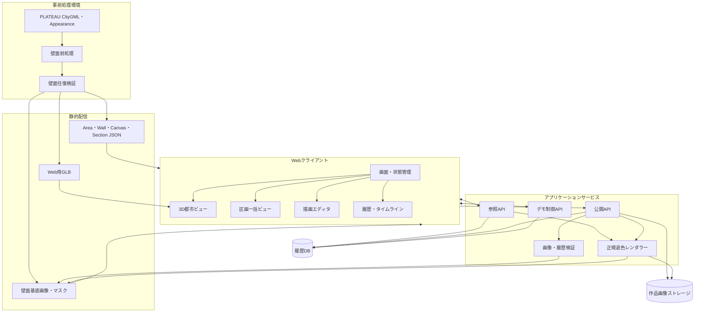
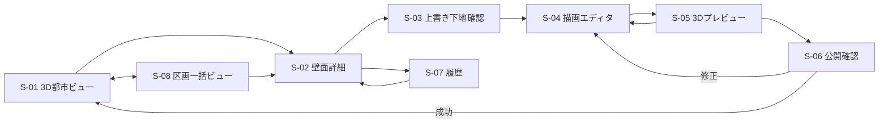
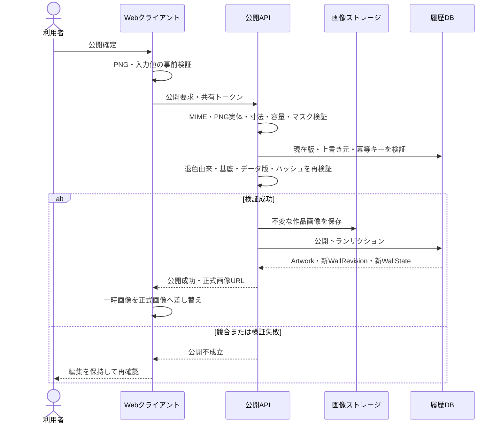
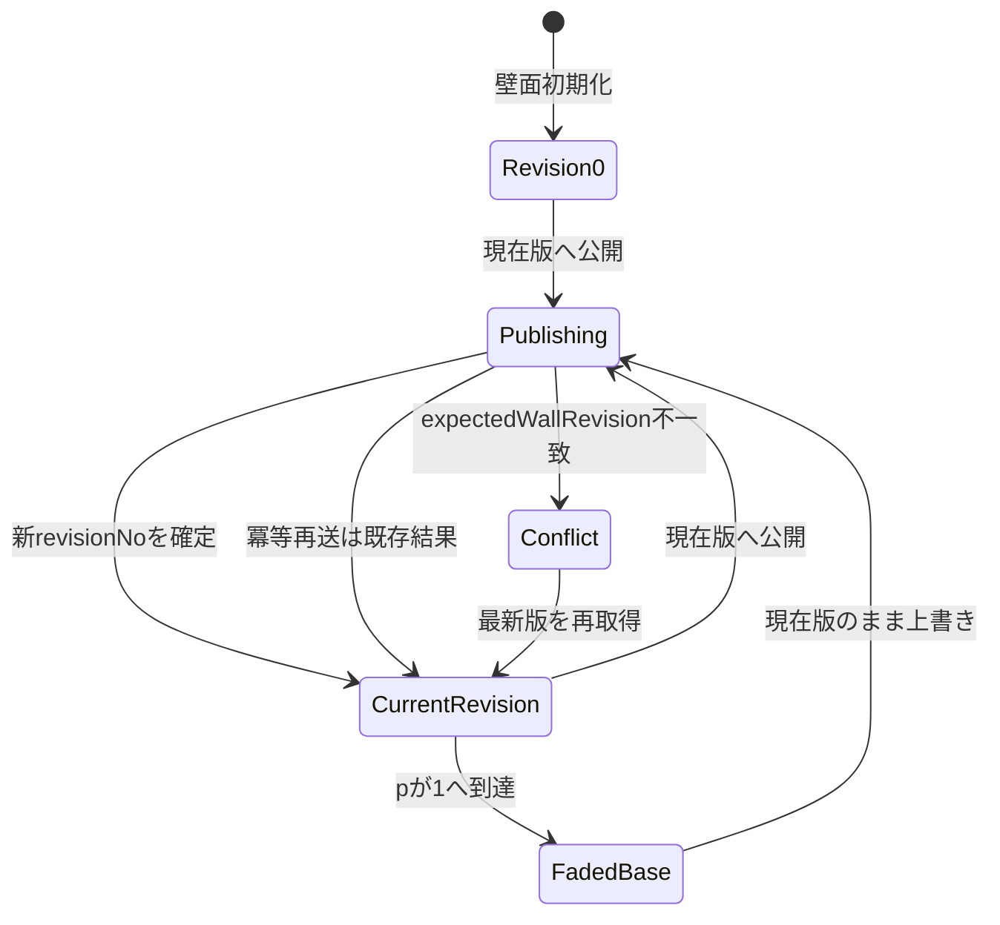

# OpenGraffiti 基本設計書

作成日: 2026-07-26  
最終更新日: 2026-08-31<br>
ステータス: 基本設計決定版（実データ・性能検証前）<br>
対象: コンテスト提出用MVP  

参照資料:

- [要件定義書](../../要件定義/要件定義書.md)
- [要件定義書 要約版](../../要件定義/要件定義書_要約版.md)
- [開発アローダイアグラム](../../開発計画/アローダイアグラム.md)
- [課題一覧](../../課題管理/課題一覧.md)
- [詳細設計 設計決定記録](../詳細設計/設計決定記録.md)

> コンセプト資料と本書が矛盾する場合は、決定版の要件定義書を優先します。本書は要件を変更する文書ではなく、要件を実装可能なシステム境界へ分解する文書です。

## 1. 目的

本書は、OpenGraffitiのMVPについて、画面、機能、データ、API、画像処理、状態遷移、エラー処理および非機能の全体構造を定義し、詳細設計と実装の共通入力にすることを目的とします。

本書では次を扱います。

- システム全体と各コンポーネントの責務
- 主要画面と画面遷移
- 現在作品への上書き、公開、履歴、退色の基本処理
- 静的設定、動的データ、画像ファイルの役割分担
- APIの論理インターフェース
- 公開処理の整合性、競合、冪等性
- 性能、セキュリティ、ログ、デモ運用
- 基本設計後に検証する事項
- 詳細設計前または発表前に決定・記録する事項

## 2. 設計対象と対象外

### 2.1 設計対象

| 領域 | 設計対象 |
|---|---|
| PLATEAU前処理 | LOD3以上の`WallSurface`抽出、openingを除く壁面選定、2D投影、UV、マスク、壁面基底画像、GLB、静的設定の生成 |
| 3D都市閲覧 | 対象エリア、描画壁面、現在作品、退色状態、壁面選択 |
| 区画一括閲覧 | 選択区画の全登録壁面と全現在作品の同時表示 |
| 描画 | 現在作品の退色状態を固定下地にした2D上書き編集 |
| プレビュー・公開 | 一時3Dプレビュー、サーバー検証、画像保存、直線履歴の更新 |
| 履歴 | 0番目から現在版までの閲覧専用タイムライン |
| 退色 | 15秒のデモ時計と共通退色レンダラー |
| デモ運用 | 再生、停止、リセット、公開制限、発表用手順 |

### 2.2 設計対象外

AR、AI描画支援、画像取込、実注目度計算、いいね、通報、モデレーション、本人認証、プロフィール、スポンサー、決済、管理ポータル、スマートフォン描画、建物解体後のモデル閲覧および本番運用設計は対象外です。

## 3. 確定済みの設計前提

以下は要件定義で確定済みであり、本書の検証・決定事項によって変更しません。

| ID | 前提 |
|---|---|
| BP-001 | 描画対象はPLATEAU実データの単純かつほぼ平面なLOD3以上の`WallSurface`とする。東京タワー周辺を主対象とし、都庁周辺はLOD3以上の正規データを確認できるまで描画対象にしない |
| BP-002 | 基準は道路2～3本、描画壁面12面、区画一括ビュー1区画とする |
| BP-003 | 各壁面は、壁面本来の外観と一致する0番目のシステム作品から開始する |
| BP-004 | 描画は常に同じ壁の現在作品へ上書きし、過去版・別壁・新規系統を下地として選べない |
| BP-005 | 描画開始時点の現在作品を、その時点の退色状態のまま固定した上書き下地を使う |
| BP-006 | 固定下地は編集不能とし、その上に最大10枚の編集レイヤーを置き、編集操作のUndo/Redoは各5回までとする |
| BP-007 | 公開画像は固定下地と表示中の編集レイヤーを統合した自己完結PNGとする |
| BP-008 | 履歴は0番目から現在版まで、欠番・分岐のない一本の系列とする |
| BP-009 | 鑑賞は3D都市ビューと、選択区画の全壁面を一度に見る区画一括ビューの2モードとする |
| BP-010 | 退色は15秒で「鮮明→色あせ→輪郭のみ→元の壁面」とし、完了後も画像と履歴を削除しない |
| BP-011 | 閲覧は匿名、描画者はデモセッションIDと表示名で識別し、公開だけを共有トークンで制限する |
| BP-012 | PC版の最新版ChromeとEdgeをサポートする |
| BP-013 | 目標日は2026-10-31、開発者1名、発表ではローカル配置の実成果物を使用する |

## 4. システム全体構成

### 4.1 論理アーキテクチャ



### 4.2 配置単位

| 配置単位 | 主な内容 | 更新頻度 |
|---|---|---|
| 静的Web配信 | SPA、GLB、静的JSON、マスク、壁面基底画像、出典・ライセンス | ビルド・データ更新時 |
| Webクライアント | 画面、Three.js表示、描画、プレビュー、退色表示 | アプリ配布時 |
| アプリケーションサービス | 参照、公開、デモ制御、サーバー検証 | アプリ配布時 |
| 履歴DB | セッション、現在版、作品メタデータ、版履歴、デモ時計 | 実行時 |
| 画像ストレージ | 公開済み統合PNG | 公開時 |
| 前処理環境 | CityGML変換、壁面選定、画像・設定生成、検証 | データ準備時 |

MVPは発表PC上のFastify 1プロセスからSPA、API、GLB、静的JSON、作品PNGを同一オリジン配信し、SQLiteと`data/`配下のファイルを使います。通常は`127.0.0.1`へbindし、必要時だけLAN公開します。リモート配置は10月MVP対象外です。

## 5. コンポーネント基本設計

| ID | コンポーネント | 責務 | 主な入力 | 主な出力 |
|---|---|---|---|---|
| C-01 | アプリシェル | 画面遷移、共通状態、エラー表示、デモ操作 | URL、セッション、API応答 | 各機能画面 |
| C-02 | 3D都市ビュー | GLB表示、壁面選択、作品オーバーレイ、退色更新 | GLB、壁面設定、現在版 | 3D都市表示、選択壁面 |
| C-03 | 壁面詳細 | 現在作品、退色、描画可否、履歴導線の表示 | 壁面詳細、現在版 | 描画・履歴への遷移 |
| C-04 | 区画一括ビュー | 区画内全壁面の同時配置、拡大、パン、詳細表示 | 区画設定、全壁面の現在版 | 一括鑑賞画面 |
| C-05 | 上書き下地生成 | 現在版とデモ時刻から固定下地と由来を生成 | 現在版、基底画像、時刻 | 固定PNG、ハッシュ、由来 |
| C-06 | 描画エディタ | 固定下地、最大10編集レイヤー、必須描画ツール、Undo/Redo各5回 | 編集コンテキスト | 編集レイヤー、一時統合PNG |
| C-07 | 3Dプレビュー | 未公開の一時統合PNGを本人の3D表示だけに適用 | 一時PNG、プレビュー姿勢 | 一時3D表示 |
| C-08 | 公開処理 | 入力検証、競合制御、画像・作品・版・現在版の確定 | 公開要求、トークン | 新Artwork、WallRevision |
| C-09 | 履歴・タイムライン | 0番目から現在版までの閲覧専用表示 | WallRevision一覧 | 選択時点の作品・由来 |
| C-10 | サーバー退色レンダラー | 全画面で同じ退色画像を決定的に生成・キャッシュ | A、B、M、pPermille、版 | 正規RGBA PNG、段階、ハッシュ |
| C-11 | デモ時計 | 仮想時刻の再生、停止、先頭化、状態通知 | 基準時刻、速度、操作 | 現在デモ時刻 |
| C-12 | デモリセット | シード状態を1分以内に復元 | 初期化シード | 再現可能なデモ状態 |
| C-13 | 壁面前処理 | 3D・2D対応、基底、マスク、静的設定を生成 | CityGML、Appearance | GLB、PNG、JSON |

コンポーネント間では`wallId`、`wallRevisionId`、`artworkId`、`wallBaseImageHash`、`plateauDataVersion`および`rendererVersion`を共通識別子として使います。

## 6. 静的成果物と動的データの境界

### 6.1 前処理成果物

```text
dataset/
├─ manifest.json
├─ models/
│  └─ area.glb
├─ areas/
│  └─ {areaId}.json
├─ walls/
│  └─ {wallId}.json
├─ sections/
│  └─ {sectionId}.json
├─ canvases/
│  ├─ {wallId}.base.png
│  └─ {wallId}.mask.png
└─ licenses/
   └─ attribution.json
```

ファイル名は論理例です。実際のパス規則は詳細設計で固定します。

`manifest.json`には少なくともデータセット版、生成日時、対象座標系、ローカル原点、GLB URL、設定スキーマ版、成果物ハッシュおよびライセンス参照を持たせます。

### 6.2 静的・動的境界

| 静的設定 | 動的保存 |
|---|---|
| Area、Building、Wall、WallCanvas | DemoSession |
| WallSection、WallSectionItem | WallState |
| GLB、基底画像、マスク | Artwork |
| プレビュー姿勢、オーバーレイ参照 | WallRevision |
| データ版、Appearance参照、出典 | DemoScenario |

静的データの`wallId`とデータ版はMVP期間中に変更しません。静的データの差し替え時は既存履歴を自動継承せず、移行または対象外化を判断します。

## 7. 画面基本設計

### 7.1 画面一覧

| ID | 画面・パネル | 主な表示 | 主な操作 |
|---|---|---|---|
| S-01 | 3D都市ビュー | PLATEAU対象エリア、描画壁面、現在作品、退色段階 | 移動、壁面選択、区画ビュー切替 |
| S-02 | 壁面詳細パネル | 壁面名、現在作品、版番号、退色、描画可否 | 描画開始、履歴表示、閉じる |
| S-03 | 上書き下地確認 | 現在版、`sourceAsOf`、退色段階、固定下地 | エディタ開始、キャンセル、再読込 |
| S-04 | 描画エディタ | 固定下地、最大10編集レイヤー、スプレー、ブラシ、マーカー、消しゴム、色、サイズ、不透明度、硬さ、粒子密度 | 描画、レイヤー、Undo/Redo各5回、プレビュー |
| S-05 | 3Dプレビュー | 対象壁面へ重ねた一時画像 | 戻る、公開確認 |
| S-06 | 公開確認 | タイトル、表示名、上書き元、3Dサムネイル | 公開、戻る |
| S-07 | 履歴・タイムライン | 0番目から現在版、作品情報、上書き元 | 時点・版選択、前後移動、閉じる |
| S-08 | 区画一括ビュー | 選択区画の全壁面・全現在作品 | 区画選択、拡大、パン、壁面詳細、3D切替 |
| S-09 | デモ操作パネル | デモ時刻、再生状態、退色段階 | 再生、停止、先頭化、リセット |
| S-10 | 共通エラー表示 | 原因、影響、再試行可否 | 再試行、戻る、テクスチャ再読込 |

S-01、S-03、S-04、S-07、S-08は独立URLとします。S-02はURLを持つサイドパネル、S-05とS-06は描画URL上のモーダルルート、S-09とS-10は共通パネルとします。確定パスは設計決定記録のUD-007に従います。

### 7.2 画面遷移



過去リビジョンを表示中のS-07には描画開始操作を置きません。描画開始は必ずS-02で再取得した現在版から行います。

### 7.3 共通表示規則

- 読込中、読込失敗、描画不可、公開中、競合、閲覧専用を色だけでなく文言またはアイコンで示します。
- 画面に表示する現在版は`WallState.currentRevisionId`を基準にします。
- 現在表示のデモ時刻はS-01、S-08、S-09で共有します。S-07および区画履歴の指定日時は閲覧画面内だけで使用し、サーバーのデモ時計を巻き戻しません。
- 一時プレビューは本人のクライアントだけに保持し、正式画像と明確に区別します。
- 未保存の編集内容がある状態でS-04を離れる場合は確認を必須にします。

## 8. 主要機能フロー

### 8.1 初期表示

1. クライアントは静的`manifest`と対象エリア設定を取得します。
2. データ版、設定スキーマ版、必須URLを検証します。
3. GLBと壁面メタデータを読み込み、描画対象オーバーレイを生成します。
4. 参照APIから全対象壁面の現在版とデモ時計を一括取得します。
5. 現在作品のサーバー生成退色PNGを取得してオーバーレイを表示します。
6. 一部画像だけ失敗した場合は該当壁面をエラー表示し、都市全体の再読込なしで再試行できるようにします。

### 8.2 描画開始

1. S-02から描画を選ぶと、クライアントは壁面の編集コンテキストを取得します。
2. サーバー基準の`sourceAsOf`、現在版、基底画像ハッシュ、データ版、レンダラー版を固定します。
3. 0番目なら基底画像を、1番目以降なら現在作品を`sourceAsOf`まで退色させた画像を生成します。
4. 生成画像と由来をS-03に表示し、利用者が確認した後だけS-04を開きます。
5. 編集開始後はデモ時計が進んでも固定下地を更新しません。

0番目を上書きするユーザー作品では、上書き元として0番目のリビジョンとArtworkを記録し、`sourceFadeStage = 元の壁面`、`sourceFadeProgress = 1.0`として扱います。

### 8.3 描画・一時プレビュー

1. 固定下地を編集不能な最下層として保持します。
2. スプレー、ブラシ、マーカー、消しゴム、色、サイズ、不透明度、ブラシ硬さ、スプレー粒子密度を提供します。にじみ、ドリップ、ステンシル、特殊合成、画像取込は提供しません。
3. 編集レイヤーだけを描画、消去、並べ替え、表示切替、削除、Undo/Redoの対象にします。
4. Undo/Redoは操作単位で各5回とし、新しい操作後はRedo履歴を破棄します。
5. プレビュー時に固定下地と表示中の編集レイヤーを一時PNGへ統合します。
6. 一時PNGを対象壁面のオーバーレイへ適用し、向き、比率、マスク境界を確認します。
7. 編集レイヤーに描画内容がない場合は、固定下地だけを公開できないようにします。
8. 一時PNGと編集レイヤーはサーバーへ保存しません。公開失敗時はタブを閉じるまでクライアントメモリに保持します。

### 8.4 公開



公開トランザクションの論理単位は次のとおりです。

1. 冪等キーの既存成功結果を確認します。
2. `expectedWallRevision`と`WallState`を比較します。
3. 上書き元リビジョン、作品、壁面、基底画像ハッシュ、データ版を照合します。
4. 旧現在版の`displayEndAt`を公開時点のデモ時刻にします。
5. `revisionNo + 1`の`WallRevision`とユーザー`Artwork`を作成します。
6. `WallState`を新しい版へ条件付き更新します。
7. 同じ冪等キーの再送には同じ成功結果を返します。

画像ストレージとDBは単一トランザクションにできないため、画像を確定候補キーへ先行保存し、DB失敗時は同じ冪等キーで再利用できる状態にします。残留画像の削除方法は詳細設計で定義します。

### 8.5 競合からの復帰

1. APIはHTTP 409と最新`currentRevisionId`を返します。
2. クライアントは編集レイヤーを保持します。
3. 最新現在版と最新デモ時刻から新しい固定下地を再生成します。
4. 利用者へ下地差し替えによって見た目が変わることを確認させます。
5. 編集レイヤーを新しい固定下地へ重ねて再プレビューします。
6. 新しい冪等キーと`expectedWallRevision`で公開し直します。

固定下地の差し替えは自動確定せず、利用者確認を必須にします。

### 8.6 履歴閲覧

- APIは壁面内の`WallRevision`を`revisionNo`昇順で返します。
- タイムラインの時刻`t`に対し、`displayStartAt <= t < displayEndAt`を満たす版を表示します。現在版は`displayEndAt = null`です。
- 選択版または指定日時をサーバーへ渡し、その版が表示されていた時点の退色PNGを表示します。
- 0番目は常に壁面基底画像として表示します。
- 過去版は閲覧専用で、描画開始ボタンを表示しません。
- 現在版へ描く場合はS-02へ戻し、現在状態を再取得します。

### 8.7 区画一括閲覧

1. 区画選択時に所属壁面と現在版を一括取得します。
2. `WallSectionItem`の順序、左右方向、表示幅、レイアウトに従って全壁面を配置します。
3. 初期表示のfit処理で登録全壁面を同一画面内へ収めます。
4. 各壁面は同じデモ時刻と共通退色レンダラーで表示します。
5. 拡大、パン、個別詳細から全体表示へ戻れるようにします。
6. 個別の「前へ」「次へ」による順送りを主導線にしません。
7. 過去日時を指定した場合は、同一DBスナップショットと同一`at`で区画内全壁の版を解決します。

### 8.8 デモ時計・リセット

- デモ時計は実時刻と分離し、基準時刻、オフセット、速度、再生状態から現在デモ時刻を算出します。
- 公開処理と編集コンテキストの`sourceAsOf`はクライアント時刻ではなくサーバーのデモ時刻を正とします。
- 再生は15秒で全退色を見せ、停止中は全画面の表示を固定します。
- 先頭化は時刻だけを戻し、データ初期化は行いません。
- リセットは所定のシード状態へデータを戻し、1分以内に同じシナリオを再実行可能にします。
- リセットは新しい`DemoScenario`をseedから作り、`ActiveScenario`を原子的に切り替えます。旧履歴は書き換えません。

## 9. 状態・時刻設計

### 9.1 壁面と版の状態遷移



`FadedBase`はDB上の別状態ではなく表示上の状態です。退色完了後も現在版は変わらず、次の上書き元として有効です。

### 9.2 エディタ状態

| 状態 | 編集内容 | 許可操作 |
|---|---|---|
| `LOADING_CONTEXT` | なし | キャンセル |
| `SOURCE_CONFIRM` | 固定下地のみ | 開始、再読込、キャンセル |
| `EDITING` | 固定下地＋編集レイヤー | 描画、Undo/Redo、プレビュー |
| `PREVIEWING` | 一時統合PNGあり | 編集へ戻る、公開確認 |
| `PUBLISHING` | 編集を凍結 | 完了待ち |
| `CONFLICT` | 編集レイヤーを保持 | 最新下地取得、キャンセル |
| `PUBLISH_FAILED` | 編集レイヤーを保持 | 同じ冪等キーで再試行 |
| `PUBLISHED` | 正式作品を受領 | 都市ビューへ戻る |

### 9.3 時刻の種類

| 時刻 | 基準 | 用途 |
|---|---|---|
| 実記録時刻 | サーバーUTC | `Artwork.createdAt`、監査ログ |
| デモ時刻 | `DemoScenario` | 表示期間、退色、`sourceAsOf` |
| クライアント表示時刻 | デモ時刻の表示用変換 | UI表示のみ。整合性判定には使わない |

APIの時刻表現はISO 8601のUTC表現を基本とします。

### 9.4 デモセッション

- 初回アクセス時にブラウザ単位の推測困難な`sessionId`を生成し、同じブラウザから再利用できる領域へ保存します。
- 表示名は公開確認時までに入力し、初回公開時に`DemoSession`を作成または更新します。
- `Artwork`には公開時の表示名をスナップショット保存し、後からセッションの表示名が変わっても履歴表示を変えません。
- セッションIDは本人認証や公開権限の根拠にせず、共有トークンを公開可否の判定に使用します。

## 10. 退色レンダラー基本設計

### 10.1 入出力

| 種別 | 内容 |
|---|---|
| 入力A | 公開済みArtworkの統合RGBA画像 |
| 入力B | 同じWallCanvasの壁面基底RGBA画像 |
| 入力M | 同じ寸法の壁面マスク |
| 時刻入力 | `fadeStartAt`と表示対象デモ時刻`t` |
| 版入力 | `rendererVersion` |
| 出力 | マスク内不透明・外側透明のRGBA画像、`p`、段階、画像ハッシュ |

進行度は`p = clamp((t - fadeStartAt) / 15秒, 0, 1)`とします。

| 範囲 | 表示段階 |
|---|---|
| `0 <= p < 1/3` | 鮮明 |
| `1/3 <= p < 2/3` | 色あせ |
| `2/3 <= p < 1` | 輪郭のみ |
| `p = 1` | 元の壁面 |

### 10.2 共通化規則

- `p = 0`はA、`p = 1`はBと画素単位で一致させます。
- 中間段階も元3D面の透過露出ではなく、AとBからRGBA画像を生成します。
- 3D都市、区画一括、履歴、上書き下地確認、エディタ、3Dプレビューは、サーバーの同じ`fade-rgba-v1`レンダーAPIを使います。
- 0番目では退色計算を行わずBをそのまま使います。
- 上書き下地生成後はデモ時計から切り離し、生成済み画像と由来を固定します。
- 公開後の新作品は統合画像全体について`p = 0`から退色を開始します。

中間補間、差分閾値、輪郭抽出、色空間、丸め、画像ハッシュは[設計決定記録](../詳細設計/設計決定記録.md)のUD-011～UD-013を正とします。

## 11. 2D・3D画像基本設計

### 11.1 キャンバス規則

- 壁面ローカル2D座標と3D壁面座標の対応を`WallCanvas`に固定します。
- キャンバスは壁面の縦横比を保持し、長辺2048px、短辺512px以上にします。
- 基底画像、マスク、上書き下地、統合画像は同じピクセル寸法を使います。
- マスク内の公開画像は完全不透明、マスク外は完全透明にします。
- 色空間、PNGエンコード、上下方向、原点、丸め方法を成果物スキーマ版で固定します。

### 11.2 3Dオーバーレイ

- 元GLBの建物テクスチャとマテリアルは変更しません。
- 描画対象面ごとに作品表示専用のオーバーレイメッシュをGLB内へ格納します。
- 壁面設定からオーバーレイのメッシュ参照とUVを取得します。
- 作品公開後は対象壁面のテクスチャだけを更新し、GLB全体を再読込しません。
- 一時プレビューはクライアント内のオブジェクトURL等を使い、正式URLと分離します。
- ちらつき対策は法線方向2mmオフセットを採用し、PoCでちらつく場合だけ`polygonOffset(-1,-1)`を追加します。

### 11.3 壁面検証

全壁面に非対称テスト画像を適用し、次を記録します。

- 元地物ID、元面ID、`wallId`の対応
- 上下左右と鏡像の有無
- 縦横比
- マスク境界
- 3D上の位置ずれ
- 基底画像と元外観の差
- オーバーレイのちらつき
- 描画可否の最終判定

## 12. データ基本設計

### 12.1 エンティティ

| エンティティ | 保存先 | 更新性 | 主キー・一意性 | 基本設計上の要点 |
|---|---|---|---|---|
| Area | 静的JSON | データ版固定 | `areaId` | 座標系、原点、GLB、出典 |
| Building | 静的JSON | データ版固定 | `buildingId` | PLATEAU地物ID対応 |
| Wall | 静的JSON | データ版固定 | `wallId` | 元面ID、描画可否、検証状態 |
| WallCanvas | 静的JSON | データ版固定 | `wallId` | 2D・3D対応、基底、マスク、ハッシュ |
| WallSection | 静的JSON | データ版固定 | `sectionId` | 一括閲覧単位 |
| WallSectionItem | 静的JSON | データ版固定 | `sectionId + wallId` | 順序、左右方向、表示幅、レイアウト |
| DemoSession | DB | 可変 | `sessionId` | 匿名描画者、表示名 |
| DemoScenario | DB | 操作時更新 | `scenarioId` | 全動的履歴のルート、仮想時計、速度、再生、seedVersion |
| ActiveScenario | DB | リセット時更新 | 固定キー1件 | 現在使用する`scenarioId`と`stateVersion` |
| WallState | DB | 公開時更新 | `scenarioId + wallId` | 現在版ポインタ、楽観ロック |
| Artwork | DB＋画像 | 公開後不変 | `artworkId` | scenario、統合画像、作者snapshot、上書き元の由来 |
| WallRevision | DB | 原則不変 | `wallRevisionId`、`scenarioId + wallId + revisionNo` | 表示期間、退色基準、直線履歴 |
| PublicationAttempt | DB | 公開処理時更新 | `scenarioId + idempotencyKey` | 要求hash、処理中・成功・失敗、同一応答の再送 |

### 12.2 必須制約

- scenario内の壁面ごとにINITIAL Artworkと`revisionNo = 0`を1件だけ持ちます。
- 壁面ごとの`revisionNo`は0から欠番なく単調増加します。
- `WallState`と現在`WallRevision`のID・番号を一致させます。
- USER Artworkの全`source*`項目を必須にします。
- USER Artworkは公開直前の現在版だけを参照できます。
- scenario内の1つの上書き元リビジョンから確定できる次作品は最大1件です。
- `Artwork`と作品画像は公開後に更新しません。
- 現在版だけ`displayEndAt = null`とします。
- `displayEndAt`は次作品公開時にだけ設定し、退色完了では設定しません。
- `WallSectionItem.order`は区画内で一意にし、同じ壁の重複登録を禁止します。
- `PublicationAttempt`の冪等キーはscenario内で一意とし、Artworkへ処理状態を持たせません。

### 12.3 推奨インデックス

| 対象 | インデックス |
|---|---|
| WallRevision | `(scenarioId, wallId, revisionNo)`一意 |
| WallRevision | `(scenarioId, wallId, displayStartAt, displayEndAt)` |
| Artwork | `(scenarioId, wallId, createdAt)` |
| Artwork | `(scenarioId, wallId, sourceWallRevisionId)`条件付き一意 |
| WallState | `(scenarioId, wallId)`一意 |
| PublicationAttempt | `(scenarioId, idempotencyKey)`一意、`createdAt` |
| DemoSession | `sessionId`一意 |

退色生成物は派生キャッシュであり、履歴エンティティにしません。キーは`artworkHash + wallBaseHash + pPermille + rendererVersion`とします。

## 13. API基本設計

### 13.1 共通規則

- 論理ベースパスは`/api/v1`とします。
- JSONはUTF-8、時刻はISO 8601 UTC、画像送信はPNGだけを許可します。
- 読取APIは匿名利用できます。
- 公開・デモ変更APIは`Authorization: Bearer <demo token>`を検証します。
- 応答には追跡用`requestId`を付けます。
- 詳細なURL、型、最大文字数、OpenAPI定義は詳細設計で確定します。

### 13.2 API一覧

| ID | メソッド・論理パス | 用途 | 主な応答・更新 |
|---|---|---|---|
| API-01 | `GET /areas/{areaId}/bootstrap` | 初期表示の一括取得 | データ版、静的URL、壁面現在版、デモ時計 |
| API-02 | `GET /walls/{wallId}` | 壁面詳細 | 現在版、退色入力、描画可否 |
| API-03 | `POST /walls/{wallId}/edit-context` | 上書き下地を時点固定 | `expectedWallRevision`、`sourceAsOf`、固定下地、由来 |
| API-04 | `GET /walls/{wallId}/revisions` | 一本の履歴取得 | 0番目から現在版の一覧 |
| API-05 | `GET /sections` | 区画一覧取得 | 区画メタデータ |
| API-06 | `GET /sections/{sectionId}/current` | 区画内全壁の一括取得 | レイアウト、全現在版、退色画像URL |
| API-07 | `GET /sections/{sectionId}/history?at=` | 区画の指定日時スナップショット | 同一時刻の各壁revisionと退色画像URL |
| API-08 | `GET /renders/{wallRevisionId}?at=` | 正規退色PNG | PNG、pPermille、段階、hash |
| API-09 | `POST /walls/{wallId}/publications` | 統合PNGの公開 | Artwork、新WallRevision、正式画像URL |
| API-10 | `GET /demo-scenarios/current` | デモ時計取得 | 基準時刻、オフセット、速度、再生状態 |
| API-11 | `GET /events` | 状態版・時計変更通知 | SSE event stream |
| API-12 | `POST /demo-scenarios/current/commands` | 再生、停止、先頭化 | 更新後デモ時計 |
| API-13 | `POST /demo-scenarios/current/reset` | シード状態へリセット | リセット結果、状態版 |

### 13.3 公開要求の主要項目

- `wallId`
- `sessionId`
- 作者表示名
- タイトル
- 統合PNG
- 画像寸法
- 画像ハッシュ
- `expectedWallRevision`
- `wallBaseImageHash`
- `plateauDataVersion`
- `sourceWallRevisionId`
- `sourceArtworkId`
- `sourceAsOf`
- `sourceFadeStage`
- `sourceFadeProgress`
- `sourceRendererVersion`
- `sourceArtworkImageHash`
- `sourceCanvasImageHash`
- クライアント生成の冪等キー

クライアント送信値は信頼せず、サーバーが静的設定、現在版、画像実体、デモ時刻および退色ロジックから再検証します。

### 13.4 論理エラーコード

| HTTP | コード例 | 画面動作 |
|---:|---|---|
| 400 | `INVALID_REQUEST`、`INVALID_PNG` | 入力箇所を示し公開しない |
| 401 | `PUBLICATION_TOKEN_INVALID` | 閲覧専用であることを表示 |
| 404 | `WALL_NOT_FOUND`、`ARTWORK_NOT_FOUND` | 都市ビューへ戻す |
| 409 | `WALL_REVISION_CONFLICT` | 編集を保持し、最新下地の確認へ進む |
| 409 | `IDEMPOTENCY_KEY_REUSED` | 同一内容なら既存結果、異なる内容なら中止 |
| 422 | `WALL_NOT_DRAWABLE`、`SOURCE_MISMATCH` | 描画・公開を禁止して再取得を案内 |
| 413 | `IMAGE_TOO_LARGE` | 編集へ戻し再生成を促す |
| 500 | `PUBLICATION_FAILED` | 編集を保持し同じキーで再試行可能にする |
| 503 | `STORAGE_UNAVAILABLE` | 編集を保持し時間を置いた再試行を案内 |

## 14. 整合性・障害回復設計

### 14.1 楽観的排他

DB更新では`wallId`と`expectedWallRevision`を条件に`WallState`を更新し、更新件数が1件の場合だけ公開を確定します。0件の場合は競合として全変更をロールバックします。

### 14.2 冪等性

- 冪等キーと公開要求の内容ハッシュを対応付けます。
- 同じキー・同じ内容の再送には以前の成功応答を返します。
- 同じキー・異なる内容は409として拒否します。
- タイムアウト後の再送でもArtworkとWallRevisionを重複作成しません。

### 14.3 画像ストレージとの整合

- 画像キーは推測困難なArtwork IDまたは内容ハッシュを含む不変キーにします。
- DB確定前にアップロードした画像は、再送で再利用できるようにします。
- DBが確定しなかった残留画像は、保持期限後に安全に削除できる状態へ分類します。
- DB確定後に画像取得できない場合は、履歴を変更せず障害として記録します。

### 14.4 キャッシュ

- GLB、基底、マスク、公開作品はハッシュ付きURLで長期キャッシュします。
- `WallState`とデモ時計は短期または再検証付きキャッシュにします。
- 公開成功後は対象壁面の現在版とテクスチャだけを無効化します。
- 退色生成物のキャッシュキーにはArtworkハッシュ、基底ハッシュ、進行度の正規化値、`rendererVersion`を含めます。

## 15. セキュリティ基本設計

| 項目 | 設計 |
|---|---|
| 閲覧 | 匿名で許可 |
| 公開 | 共有トークンが設定・一致した場合だけ許可 |
| デモ変更 | 公開と同等以上のトークン検証を行う |
| ファイル | MIMEヘッダーだけでなくPNGシグネチャとデコード結果を検証 |
| 画像制限 | 寸法、容量10MB以下、RGBA、マスク内外、データ版を検証 |
| 入力文字列 | 表示名・タイトルを長さ制限し、HTMLとして解釈しない |
| 秘密情報 | トークン、ストレージ秘密鍵、DB接続情報をクライアントへ含めない |
| ログ | トークン、画像本体、不要な個人情報を記録しない |
| 配信 | ローカル主系は`127.0.0.1`の同一オリジンHTTPとし、外部/LANへ公開する場合だけHTTPS終端を必須にする。CSP、同一オリジンCORS、依存固定・監査を行う |
| 濫用抑止 | 公開APIへ壁面または送信元単位の最低限のレート制限を設ける |

共有トークンは本人認証ではなく、デモの誤操作・無関係投稿を抑えるための公開制限として扱います。

## 16. 非機能基本設計

| 要件 | 設計方針 | 確認方法 |
|---|---|---|
| 初回表示8秒以内 | 対象範囲縮小、GLB軽量化、静的配信、遅延読込 | 基準端末・20Mbpsで計測 |
| 詳細1秒、エディタ2秒 | 壁面設定の先読込、現在版APIの一括化、画像キャッシュ | 操作計測 |
| 公開5秒または10秒以内 | 画像のクライアント事前検証、単一公開API、対象テクスチャだけ更新 | 5MB以下・10MB以下で計測 |
| 描画30fps以上 | ポインタイベント集約、描画領域限定、必要時Worker利用 | 連続ブラシ操作を計測 |
| 区画12壁面3秒以内 | 一括API、画像並列取得、初期fit、キャッシュ | 12壁面で計測 |
| 履歴21版2秒以内 | 壁面単位インデックス、一覧メタデータと選択画像の分離 | 21版で計測 |
| 回復性 | 機能単位の再試行、編集メモリ保持、テクスチャ単体再読込 | 障害注入 |
| 再現性 | サーバー基準デモ時刻、`rendererVersion`、画像ハッシュ | 全表示箇所の比較 |
| 保守性 | 前処理、3D、描画、公開、履歴、退色、デモ時計を分離 | モジュール依存レビュー |
| コスト | 静的配信優先、12壁面・21版以下、無料枠上限を記録 | 使用量見積もり |

性能計測条件はWindows 11 Home build 26100、1920×1080フルスクリーン、Chrome 152以降/Edge 151以降、i9-14900K、64GiB、RTX 4080 SUPER 16GBを主基準とします。Intel UHD 770では機能縮退がなく30fps以上となることも確認します。ローカル配信のため回線速度は受け入れ条件にしません。

## 17. ログ・監視・運用

### 17.1 ログ

| ログ | 主な項目 |
|---|---|
| APIアクセス | `requestId`、API、結果、処理時間、HTTP状態 |
| 公開監査 | `wallId`、旧・新revisionNo、Artwork ID、冪等キー、結果 |
| 競合 | `wallId`、expected、actual、発生時刻 |
| 画像障害 | URL種別、壁面、ハッシュ不一致、デコード失敗 |
| デモ操作 | 操作、実行者区分、前後の時計状態 |
| 前処理検証 | データ版、壁面、検査項目、合否、成果物ハッシュ |

### 17.2 デモ運用

- 発表前にデータ版、アプリ版、`rendererVersion`、初期化シードを固定します。
- 起動確認、初期化、描画、公開、履歴、2つの鑑賞モード、退色を一巡します。
- ローカル実成果物を主系とし、事前収録を障害時の代替として用意します。
- ライセンスとPLATEAU出典を成果物から確認できるようにします。
- ISSUE-001は「使用する」、ISSUE-002は「ローカル配置」で決定済みです。

## 18. 検証事項

検証事項は製品方針を再決定する課題ではなく、選択済み要件と設計が実データ・実環境で成立するか確認する作業です。

| ID | 検証事項 | 方法 | 合格条件 | 実施時期・ゲート |
|---|---|---|---|---|
| BV-001 | PLATEAU対象データの成立性 | 港区2025仕様5.0のLOD3 CityGMLでWallSurface、opening、Appearance、元IDを調査 | 東京タワー周辺で描画可能壁面12面を抽出でき、IDを追跡できる | G-01 |
| BV-002 | 1壁面の2D・3D往復 | 非対称画像と基底画像を投影 | 鏡像・上下逆なし、位置ずれ1%以内 | G-02 |
| BV-003 | 壁面基底画像の忠実度 | unlit・同一解像度で元面と比較 | 境界1pxを除くRGB平均絶対誤差5以下 | G-02 |
| BV-004 | オーバーレイのちらつき | 2mm法線offsetを主要視点で確認し、不合格時だけpolygonOffsetを追加 | 基準端末・主要視点でちらつかない | G-02 |
| BV-005 | 0番目の初期化 | Artwork、Revision、WallStateを全壁確認 | 12壁面すべてrevisionNo 0から開始 | D完了時 |
| BV-006 | 退色の決定性 | 同一入力を全表示箇所で生成・比較 | 生成結果の規定ハッシュが一致 | I完了時 |
| BV-007 | 退色終端の外観 | `p = 1`の画像と基底画像を比較 | マスク内が画素一致、外側が透明 | I完了時 |
| BV-008 | 固定下地の不変性 | 消しゴム、削除、Undo/Redoを操作 | 固定下地のピクセルと由来が変化しない | I完了時 |
| BV-009 | 画像出力制約 | 各縦横比で統合PNGを生成 | 長辺2048、短辺512以上、10MB以下、マスク適合 | I完了時 |
| BV-010 | 公開の競合・冪等性 | 同時公開、再送、タイムアウトを注入 | 分岐・重複・現在版不整合が発生しない | I・N完了時 |
| BV-011 | ストレージ部分障害 | 保存成功後DB失敗、DB成功後読込失敗を再現 | 現在版を壊さず再試行・復旧できる | N完了時 |
| BV-012 | 直線履歴 | 1壁面へ20回連続公開 | 0～20が欠番・分岐なく前後参照可能 | N完了時 |
| BV-013 | 区画一括レイアウト | 12壁面を1280×720と1920×1080へ初期表示 | 成功した全壁が画面内に収まり向き・順序が正しく、失敗壁はfit対象外 | K完了時 |
| BV-014 | 3D・区画の状態一致 | 同じデモ時刻で全壁を比較 | 現在版、退色段階、画像が一致 | K・N完了時 |
| BV-015 | 描画性能 | 各ツールを連続操作 | 30fps以上、入力点欠落による線切れなし | N完了時 |
| BV-016 | 画面性能 | 基準データ・回線で計測 | NFR-001～003、018、020を満たす | N完了時 |
| BV-017 | リセット再現性 | 公開・退色後にリセットを反復 | 1分以内、同じシードで同じ状態 | N・O完了時 |
| BV-018 | ブラウザ互換 | 最新ChromeとEdgeで受け入れ操作 | 必須機能と見た目に重大差がない | N完了時 |
| BV-019 | セキュリティ入力 | 不正トークン、偽MIME、超過画像、別壁参照を送信 | 閲覧を壊さず公開だけを拒否 | N完了時 |
| BV-020 | ライセンス・出典 | 成果物と依存一覧を照合 | PLATEAU版・出典・OSSライセンスを確認可能 | O完了時 |
| BV-021 | ローカル発表再現性 | 同じ版・seedで主要シナリオと事前収録切替を実施 | reset 1分以内、実成果物と収録の説明内容が一致 | O完了時 |

## 19. 決定・検証状態

設計判断は2026-08-31に全件決定しました。具体値、採用理由、外部データ制約は[設計決定記録](../詳細設計/設計決定記録.md)を正とします。

| 区分 | 状態 | 扱い |
|---|---|---|
| BD-001～BD-003 | 決定済み | 東京タワー周辺LOD3、2026-10-31・1名・実端末、ローカル技術構成を記録済み |
| BD-004～BD-016 | 決定済み | Canvas 2D、Fastify/SQLite/filesystem、server退色、hash、scenario、clock、履歴、区画、token、resetを決定済み |
| BD-017 | 決定済み | 発表で実成果物を使用する |
| BD-018 | 決定済み | ローカル配置を採用し、リモートは10月MVP対象外 |

残るのはBV-001～BV-004およびUD-029～UD-031の実測です。方式を決めるための未確定事項ではなく、採用済み方式の合否確認として扱います。

## 20. 詳細設計への分割

詳細設計ディレクトリでは、少なくとも次の単位へ分割します。

| 詳細設計ID | 文書 | 主な内容 |
|---|---|---|
| DD-01 | フロントエンド・画面詳細設計 | ルーティング、画面項目、状態管理、操作、アクセシビリティ |
| DD-02 | 3D都市・壁面前処理詳細設計 | 座標変換、UV、GLB、オーバーレイ、静的JSONスキーマ |
| DD-03 | 描画エディタ詳細設計 | ツール、レイヤー、Undo/Redo、マスク、PNG統合 |
| DD-04 | 退色レンダラー詳細設計 | 画素アルゴリズム、版管理、ハッシュ、テストベクトル |
| DD-05 | API詳細設計 | OpenAPI、要求・応答、認可、エラー、冪等性 |
| DD-06 | DB・ストレージ詳細設計 | テーブル、型、制約、索引、画像キー、公開トランザクション |
| DD-07 | 区画一括・履歴・デモ制御詳細設計 | レイアウト、タイムライン、時計、リセット |
| DD-08 | インフラ・運用詳細設計 | ローカル環境、配置、秘密情報、ログ、バックアップ、復旧 |
| DD-09 | テスト詳細設計 | 単体、結合、受け入れ、性能、障害注入、デモリハーサル |

## 21. 要件対応

| 要件領域 | 基本設計の主対応章 |
|---|---|
| FR-001～008 都市ビュー | 4、5、7、8、11 |
| FR-101～115 壁面抽出 | 6、11、18 |
| FR-201～224 描画 | 7、8、9、11 |
| FR-301～313 保存・反映 | 8、12～14 |
| FR-401～408 履歴 | 7～9、12、13 |
| FR-501～505 区画一括 | 7、8、12、13 |
| FR-601～607 退色 | 8～10 |
| FR-701～704 セッション・公開制限 | 12、13、15 |
| FR-801～803 管理・設定 | 6、8、17 |
| NFR-001～020 | 10、14～18 |
| AC-001～030 | 18 |

## 22. 基本設計完了条件

次を満たした時点で、本書を基本設計の決定版に更新し、詳細設計へ進みます。

1. BP-001～013が要件定義書と一致している。
2. 論理コンポーネント、画面、データ、APIの責務に欠落・重複がない。
3. BD-001～018の決定値が設計決定記録と一致している。
4. `scenarioId`、`PublicationAttempt`、server退色を含むエンティティ・APIが反映されている。
5. BV-001～004およびUD-029～UD-031の検証計画と合格条件が記録されている。
6. API、DB、退色、3D、画面の各詳細設計担当へ引き渡せる。
7. 設計判断の未決課題がなく、検証待ちを合格済みと誤記していない。
