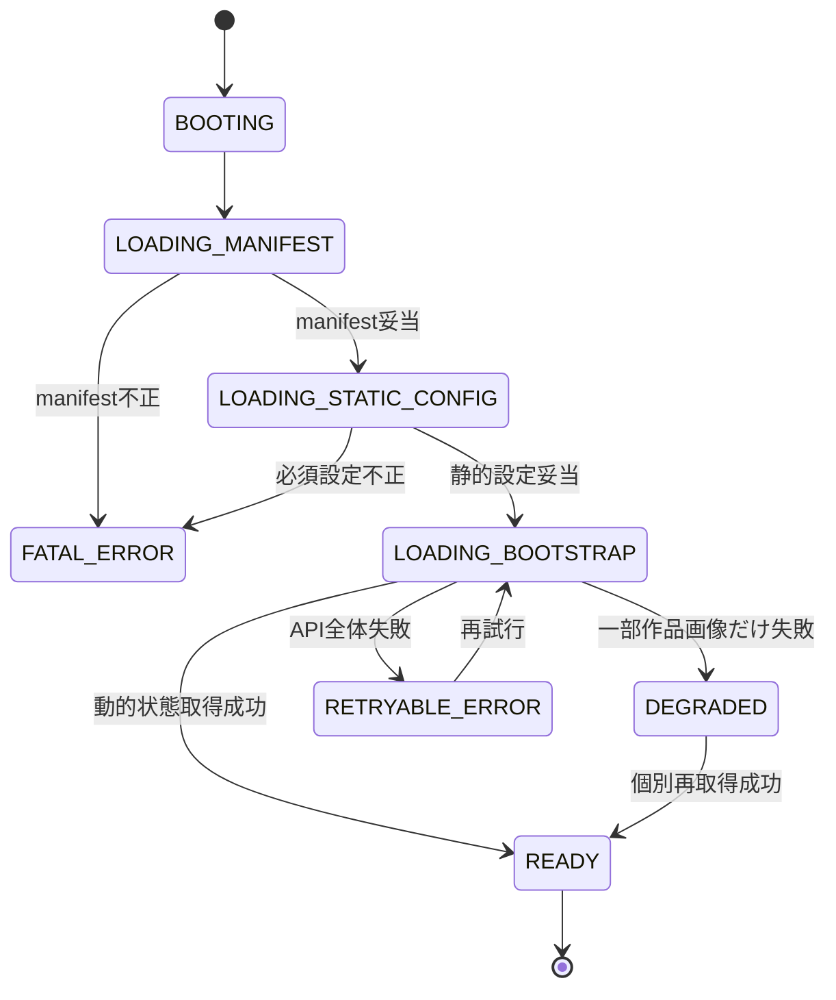

# F-01 アプリ起動・共通制御 詳細設計

作成日: 2026-08-22  
ステータス: 詳細設計ドラフト（未確定事項あり）

## 1. 目的

Webクライアントの起動、静的データと動的状態の整合確認、共通状態の保持、機能間遷移、共通エラーおよび再試行を担当します。本機能は個別機能の業務処理を持たず、各機能が同じデータ版、デモ時刻、セッションおよび選択状態を参照できるようにします。

## 2. 対応要件

- FR-001～008、FR-701、FR-702、FR-704
- NFR-001、NFR-002、NFR-005、NFR-006、NFR-008、NFR-013、NFR-015
- AC-001、AC-002、AC-011、AC-018、AC-019

## 3. 前提・依存

| 項目 | 内容 |
|---|---|
| 静的成果物 | F-02が生成した`manifest`、GLB、壁面・区画設定、基底画像、マスク |
| 動的状態 | 参照APIから取得する`WallState`、Artwork、WallRevision、DemoScenario |
| セッション | F-12が管理する`sessionId`と表示名 |
| 退色 | F-10の共通退色レンダラー |
| 対応環境 | PC版の最新版Chrome、Edge |

具体的なフロントエンド構成とURL設計はUD-004、UD-007が未確定です。

## 4. クライアント共通状態

| 状態名 | 主な項目 | 更新契機 | 永続化 |
|---|---|---|---|
| `application` | アプリ版、起動状態、閲覧専用フラグ | 起動、トークン状態変更 | しない |
| `dataset` | `areaId`、データ版、schemaVersion、GLB URL、成果物ハッシュ | manifest読込 | しない |
| `wallCatalog` | Wall、WallCanvas、描画可否、静的検証状態 | 起動 | HTTPキャッシュのみ |
| `sectionCatalog` | WallSection、WallSectionItem | 起動 | HTTPキャッシュのみ |
| `wallCurrentMap` | 壁面ごとの現在版・現在作品・退色入力 | bootstrap、公開成功、再読込 | しない |
| `demoClock` | 基準時刻、オフセット、速度、再生状態、取得時刻 | bootstrap、F-11操作、再同期 | しない |
| `navigation` | 表示機能、選択`wallId`、選択`sectionId` | 利用者操作 | UD-007で決定 |
| `session` | `sessionId`、表示名 | 初回起動、表示名入力 | UD-023で決定 |
| `editing` | 編集コンテキスト、編集レイヤー、一時PNG、dirty | F-04～F-07 | メモリのみ |
| `errors` | 機能、コード、再試行可否、`requestId` | 障害発生・解消 | しない |

公開失敗時に保持する編集状態を、ページ再読込やタブ終了をまたいで保存しません。

## 5. 起動状態

| 状態 | 画面 | 許可操作 |
|---|---|---|
| `BOOTING`～`LOADING_BOOTSTRAP` | 起動中表示 | なし |
| `READY` | 3D都市ビュー | 全許可機能 |
| `DEGRADED` | 3D都市ビュー＋該当壁面エラー | 閲覧継続、個別再試行 |
| `RETRYABLE_ERROR` | 再試行可能エラー | 再試行 |
| `FATAL_ERROR` | 設定不整合 | 再読込、終了。描画不可 |

## 6. 起動処理

1. クライアントのアプリ版と対応する設定スキーマ版を確定します。
2. `manifest`を取得します。
3. 必須項目、schemaVersion、PLATEAUデータ版、成果物URL、成果物ハッシュの形式を検証します。
4. Area、Wall、WallCanvas、WallSection、WallSectionItemを取得します。
5. 次の静的整合性をクライアントでも確認します。
   - 全描画可能WallにWallCanvasが1件ある。
   - `wallId`、`sectionId`参照が解決できる。
   - 基底画像、マスク、GLB参照が存在する。
   - 同一区画の順序と壁面が重複しない。
6. 論理API `GET /api/v1/areas/{areaId}/bootstrap`を呼び出します。
7. 応答のデータ版がmanifestと一致することを確認します。
8. 全描画可能壁面について、現在版、現在作品、退色入力の有無を確認します。
9. `sessionId`を取得または生成します。生成・保存方式はUD-023確定後に実装します。
10. F-03へGLB URL、壁面カタログ、現在版マップ、デモ時計を渡します。
11. 初期カメラと3D都市ビューを表示します。

## 7. Bootstrap論理応答

| 項目 | 必須 | 内容 |
|---|---|---|
| `areaId` | 必須 | 静的設定と同一の対象エリア |
| `plateauDataVersion` | 必須 | 静的設定との照合用 |
| `serverRecordedAt` | 必須 | 応答生成の実時刻 |
| `demoScenario` | 必須 | デモ時計の基準、速度、再生状態、rendererVersion |
| `walls[]` | 必須 | 対象壁面の現在状態 |
| `walls[].wallId` | 必須 | 静的Wallへの参照 |
| `walls[].currentRevision` | 描画可能壁面で必須 | 現在WallRevision |
| `walls[].currentArtwork` | 描画可能壁面で必須 | 現在Artworkの表示情報 |
| `walls[].displayImageUrl` | 必須 | 自己完結した現在作品画像。0番目は基底画像でよい |
| `walls[].drawable` | 必須 | サーバー側の描画可否 |
| `readOnlyReason` | 条件付き | 共有トークン未設定等の公開不可理由 |

正確な型、null規則、URL、キャッシュヘッダーはUD-015で確定します。

## 8. 共通遷移制御

| 遷移 | 事前条件 | dirty時の扱い |
|---|---|---|
| 3D都市→壁面詳細 | 有効な`wallId` | 該当なし |
| 壁面詳細→描画開始 | 描画可能、最新編集コンテキスト取得可能 | 該当なし |
| エディタ→3Dプレビュー | 編集レイヤーに描画あり、PNG生成可能 | dirtyを保持 |
| エディタ・プレビュー→他機能 | 利用者が移動を要求 | 破棄確認を表示 |
| 公開成功→3D都市 | 正式Artwork受領 | editingを破棄 |
| 3D都市↔区画一括 | 対象データ取得可能 | 該当なし |
| 壁面詳細→履歴 | 履歴取得可能 | 該当なし |

ブラウザ戻る・直接URL・リロード時の具体動作はUD-007で確定するまで実装値を置きません。

## 9. 共通エラー表示

エラー表示には次を含めます。

- 利用者向け概要
- 影響する機能
- 編集内容が保持されているか
- 再試行、戻る、テクスチャ再読込等の許可操作
- 問い合わせ・デモ確認用`requestId`

| 事象 | 画面動作 |
|---|---|
| manifest・静的設定不整合 | 起動中止。描画・公開を許可しない |
| bootstrap失敗 | 起動画面で機能単位の再試行 |
| 一部作品画像失敗 | 都市を表示し、該当壁面だけエラー表示 |
| デモ時計再同期失敗 | 最終取得値を表示し、同期異常を明示。描画開始は新規コンテキスト取得で再検証 |
| 正式テクスチャ反映失敗 | 公開済みを明示し、対象テクスチャだけ再読込 |

## 10. 性能・キャッシュ

- 初回操作可能表示8秒以内を目標とします。
- manifestと小さい設定を先に検証し、GLB・画像取得を並行化できます。
- ハッシュ付き静的成果物は長期キャッシュし、WallStateとデモ時計は再検証可能な短期キャッシュにします。
- 実際の並列数、タイムアウト、再試行はUD-025で決定します。
- 起動計測点は「ナビゲーション開始」「3D操作受付開始」「全現在作品初期反映完了」を分けて記録します。

## 11. ログ

| イベント | 必須項目 |
|---|---|
| 起動開始・完了 | アプリ版、areaId、データ版、所要時間 |
| 静的設定不整合 | ファイル種別、schemaVersion、対象ID、エラーコード |
| Bootstrap失敗 | requestId、HTTP状態、再試行回数 |
| 機能遷移失敗 | 遷移元、遷移先、wallIdまたはsectionId |

出力先と保持期間はUD-026で確定します。

## 12. テスト観点

- 正常な静的設定と0番目だけの状態で3D都市ビューを開始できる。
- データ版不一致時に描画を開始できない。
- WallCanvas欠損、参照先欠損、重複section順序を検出できる。
- 動的APIの一部画像失敗時に都市全体を操作不能にしない。
- 共有トークン未設定時に閲覧でき、公開導線は閲覧専用表示になる。
- ChromeとEdgeで共通遷移が成立する。
- 未保存編集がある状態で離脱確認が働く。
- 初回表示の性能計測ログが取得できる。

## 13. 未確定事項

UD-001～004、UD-007、UD-009、UD-015、UD-020、UD-023、UD-025、UD-026およびISSUE-002を参照してください。
