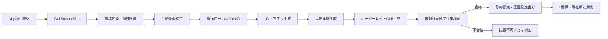

# F-02 壁面前処理・初期化 詳細設計

作成日: 2026-08-22  
ステータス: 詳細設計ドラフト（未確定事項あり）

## 1. 目的

PLATEAU CityGMLとAppearanceから描画対象壁面を選定し、3D表示と2D描画を一意に対応させる静的成果物を生成します。検証に合格した各壁面について、壁面基底画像と一致する0番目のArtwork、WallRevision、WallStateを初期化します。

## 2. 対応要件

- FR-101～115、FR-501、FR-502、FR-801～803
- NFR-011、NFR-013、NFR-019
- AC-001、AC-002、AC-006、AC-018、AC-020、AC-027、AC-030

## 3. 入力

| 入力 | 必須内容 | 備考 |
|---|---|---|
| CityGML | LOD2建築物、`bldg:WallSurface`、構成ポリゴン、地物ID・面ID | 実行時には解析しない |
| Appearance | 元マテリアル、テクスチャ、UVまたは対応参照 | 基底画像生成に必須 |
| 対象範囲 | 都市、年度・版、メッシュ、道路2～3本程度 | 具体値はUD-001 |
| 選定条件 | 道路視認性、平面性、面積、遮蔽物、形状、縦横比 | 目視判定を含む |
| 区画設定案 | 区画名、所属壁面候補、道路順、左右方向 | 最終レイアウトは検証する |

## 4. 出力

| 出力 | 主な内容 |
|---|---|
| `manifest` | データ版、座標系、ローカル原点、GLB URL、schemaVersion、成果物ハッシュ、出典 |
| Web用GLB | 対象エリアのモデル、作品用オーバーレイ参照可能な構造 |
| Area・Building・Wall設定 | アプリIDとPLATEAU元IDの対応、描画可否、検証状態 |
| WallCanvas設定 | ローカル2D座標、UV、マスク、基底画像、ハッシュ、プレビュー姿勢 |
| WallSection設定 | 区画情報、壁面順序、左右方向、表示幅、レイアウト |
| PNG | 壁面基底画像、描画マスク、非対称検証画像 |
| 検証記録 | 壁面単位の向き、比率、誤差、外観差、ちらつき、合否 |
| 初期データ | 0番目Artwork、revisionNo 0のWallRevision、WallState |
| ライセンス資料 | PLATEAU版・出典、使用ツール・OSSのライセンス |

確定ファイル名とJSON SchemaはUD-009で決定します。

## 5. 処理パイプライン



## 6. WallSurface抽出・選定

1. 対象CityGMLからLOD2建築物を列挙します。
2. `bldg:WallSurface`と構成ポリゴンを抽出し、元地物ID・元面IDを失わない中間形式へ格納します。
3. 対象地域の座標参照系からアプリ内ローカル座標へ変換します。
4. 面法線、平面からの最大偏差、幅、高さ、面積、縦横比を計算します。
5. 道路からの視認性、遮蔽物、形状の複雑さを目視確認します。
6. 次に該当する面は対象外にできます。
   - 曲面または著しく非平面
   - 穴・凹凸が多い
   - 複数平面をまたぐ
   - 縦横比が1:4～4:1の範囲外
   - Appearanceから基底画像を生成・検証できない
7. デモに用いる12面を基準に手動確定し、不変な`wallId`を付与します。

平面性等の数値閾値は実データ検証で必要になるため、確定値がないままコードへ埋め込みません。選定記録には計算値と手動判断理由を残します。

## 7. 壁面ローカル2D投影

### 7.1 論理座標

壁面上に原点`O`、水平単位軸`U`、垂直単位軸`V`を定義します。3D頂点`P`の2D座標は次で求めます。

```text
x = dot(P - O, U)
y = dot(P - O, V)
```

`U`、`V`の向きは非対称テスト画像の文字・角マーカーで検証し、鏡像や上下反転を許可しません。軸の算出規則と座標系の具体値はUD-001、UD-009の確定対象です。

### 7.2 画像寸法

1. 2Dポリゴンの幅`W`と高さ`H`を算出します。
2. 長辺を2048pxにします。
3. 短辺を縦横比から算出します。
4. 短辺が512px未満となる壁面は選定条件と矛盾するため、対象外化または選定見直しを行います。縦横比を歪めて512pxへ引き伸ばしません。
5. 全座標をピクセル座標へ写像し、同じ寸法でマスク、基底、検証画像を生成します。

## 8. マスク・壁面基底画像

### 8.1 マスク

- 投影した壁面ポリゴン内部を描画可能、外部を描画不可とします。
- マスク境界のラスタライズ規則は同一ツール・同一版で固定します。
- 公開PNGではマスク内を完全不透明、外側を完全透明にします。

### 8.2 基底画像

1. CityGML Appearanceまたは変換後モデルの元マテリアル・テクスチャ・UVを解決します。
2. 対象WallSurface本来の外観だけを壁面ローカル2D座標へ再描画します。
3. マスク内を不透明、外側を透明にします。
4. 元Appearance参照、PLATEAUデータ版、画像寸法、画像ハッシュを記録します。
5. 欠損・不一致・読込失敗時は白色等へ代替せず、壁面を描画不可にします。

画像ハッシュの対象と方式はUD-013で決定します。

## 9. 3Dオーバーレイ成果物

- 元の建物マテリアルとテクスチャは変更しません。
- 作品用に壁面と対応する別オーバーレイメッシュまたは別マテリアルを生成します。
- `WallCanvas`から対象GLBノードまたはプリミティブを一意に参照できるようにします。
- UVは2D画像の上下左右と一致させます。
- ちらつき対策はUD-028の比較結果が出るまで確定しません。
- プレビュー用のカメラ位置、注視点、上方向を壁面単位で出力します。算出・手動補正規則はUD-008、UD-009で確定します。

## 10. 区画設定

1. 1区画を基準として`sectionId`を付与します。
2. 所属する全壁面について、道路順、左右方向、表示幅、レイアウト枠を記録します。
3. 同一区画内で順序を一意にし、同じ壁面を重複登録しません。
4. 1920×1080初期表示で全壁面が画面内へ収まることを検証します。
5. 実際の比率・向き・間隔からレイアウト実値を決めるため、UD-022、UD-031が確定するまでTBDとします。

## 11. 壁面往復検証

検証画像は少なくとも、上下左右を識別できる文字、異なる四隅色、中心線、マスク境界を持たせます。

| 検証 | 合格条件 |
|---|---|
| 元ID追跡 | `wallId`から元地物ID・元面IDへ一意に辿れる |
| 向き | 上下逆・鏡像・90度回転がない |
| 縦横比 | 2D画像と3D壁面の比率が一致 |
| 位置 | 壁面境界に対する位置ずれが外接矩形の1%以内 |
| マスク | 面外を表示せず、必要な面内を欠損しない |
| 外観 | unlit・同一解像度で境界1pxを除くRGB平均絶対誤差5以下 |
| ちらつき | UD-028で選んだ方式により主要視点で発生しない |

不合格面は`drawable = false`とし、補正後に全検証を再実行します。

## 12. 0番目・現在版初期化

検証合格した各描画壁面に対し、単一の初期化処理で次を生成します。

| データ | 値 |
|---|---|
| Artwork | `artworkType = INITIAL`、画像は基底画像を再利用可、`imageHash = wallBaseImageHash` |
| Artworkの作者情報 | `sessionId`、表示名、タイトル、冪等キー、全`source*`をnull |
| WallRevision | `revisionNo = 0`、初期Artworkを参照、`fadeStartAt = null` |
| WallRevision表示期間 | `displayStartAt = デモシナリオ開始時刻`、`displayEndAt = null` |
| WallState | 初期WallRevisionを現在版とし、`currentRevisionNo = 0` |

初期化後に全描画壁面を照合し、1件でもINITIAL・Revision・WallStateの組が欠ける場合は、その壁面を描画可能として配信しません。

## 13. 再実行性

- 前処理は入力版と設定が同一なら、同じ識別子・寸法・座標・成果物ハッシュを再生成できることを目標にします。
- 手動補正値はGUI内だけに残さず、バージョン管理可能な設定へ保存します。
- 既存動的履歴があるデータ版へ静的成果物を上書きしません。
- PLATEAUデータ版または基底画像を変更する場合は別データセットとして生成し、移行判断を必要とします。

## 14. エラー・ログ

| 事象 | 処理 |
|---|---|
| WallSurfaceまたは元ID欠損 | 候補から除外し理由を記録 |
| Appearance解決不可 | 描画不可。代替基底を生成しない |
| 投影失敗・非平面 | 描画不可または手動選定へ戻す |
| GLB参照解決不可 | 描画不可。静的成果物を配信しない |
| 往復検証不合格 | `drawable = false`、補正履歴を記録 |
| 初期DB生成失敗 | 当該壁面を公開対象にせず、初期化処理を再実行 |

ログには入力データ版、ツール版、wallId、元ID、各計測値、合否、成果物ハッシュを含めます。ログ形式・保存先はUD-026です。

## 15. テスト観点

- 1壁面でCityGML→基底→0番目→2D描画→3D再投影が成立する。
- 異なる縦横比の対象壁面で画像寸法規則を守る。
- Appearance欠損時に白色下地へ代替しない。
- 非対称画像で全壁面の向き・境界・誤差を判定できる。
- 同じ入力から同じwallId対応と成果物を再生成できる。
- 12壁面すべてに0番目と現在版が1件ずつある。
- 区画内の順序・壁面参照に重複がない。
- 出典・データ版・使用OSSを成果物から確認できる。

## 16. 未確定事項

UD-001、UD-003、UD-009、UD-010、UD-013、UD-022、UD-026、UD-028、UD-031、UD-051～053を参照してください。
