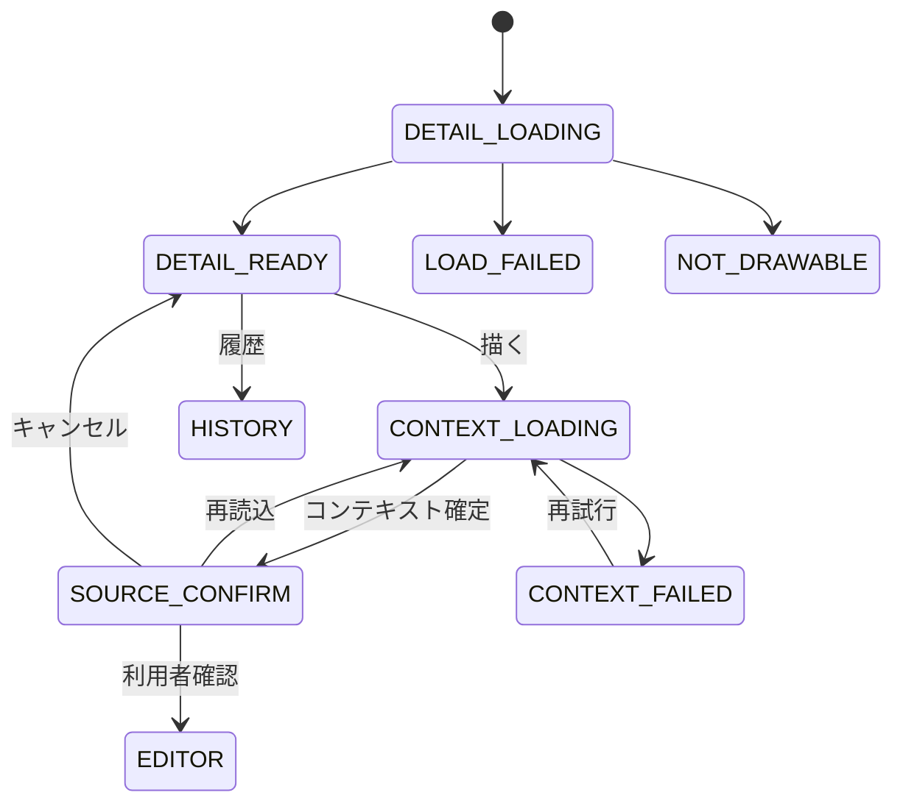

# F-04 壁面詳細・描画開始 詳細設計

作成日: 2026-08-22  
ステータス: 詳細設計ドラフト（未確定事項あり）

## 1. 目的

選択された壁面の現在状態を表示し、履歴閲覧または現在作品への上書き描画へ案内します。描画開始時にはサーバー基準の現在版とデモ時刻を固定し、現在作品のその時点の退色状態を編集不能な上書き下地として生成・確認します。

## 2. 対応要件

- FR-004、FR-201、FR-213、FR-215～224
- NFR-002、NFR-007、NFR-008、NFR-017、NFR-018
- AC-013、AC-020～025、AC-028～030

## 3. 画面構成

### 3.1 壁面詳細

| 項目 | 表示内容 | 表示条件 |
|---|---|---|
| 壁面 | 表示名、`wallId`、描画可否 | 常時 |
| 現在作品 | サムネイル、revisionNo、タイトル、表示名 | 現在版取得成功時 |
| 0番目 | 「元の壁面」、作者なし | revisionNo 0 |
| 退色 | 段階、進行度、基準デモ時刻 | 現在版取得成功時 |
| 描く | 「この壁に描く」 | 描画可能かつ必要データ正常時だけ |
| 履歴 | 「履歴を見る」 | Revision一覧取得可能時 |
| エラー | 描画不可理由、再読込 | 設定・画像・現在版の不備時 |

### 3.2 上書き下地確認

| 項目 | 内容 |
|---|---|
| 壁面 | 対象壁面名・ID |
| 現在版 | `expectedWallRevision`、revisionNo、現在Artwork |
| 描画開始時点 | `sourceAsOf` |
| 退色由来 | 段階、進行度、rendererVersion |
| 固定下地 | 生成済み上書き下地画像 |
| 説明 | 「現在の壁のこの状態へ描き足す」ことを明示 |
| 操作 | エディタ開始、再読込、キャンセル |

過去作品、別の壁、白い壁を選ぶ操作は置きません。「再読込」の厳密な意味はUD-033で確定します。

## 4. 状態

`CONTEXT_LOADING`開始後に現在版が変わった場合、異なる版の情報を混ぜず、処理を再実行または競合相当のエラーにします。

## 5. 壁面詳細取得

論理APIは`GET /api/v1/walls/{wallId}`です。

### 5.1 応答項目

| 項目 | 必須 | 用途 |
|---|---|---|
| `wallId` | 必須 | 静的設定との照合 |
| `drawable` | 必須 | 描画導線の制御 |
| `notDrawableReason` | 条件付き | 描画不可理由 |
| `currentRevision` | 描画可能壁で必須 | 現在版、表示期間、退色開始、rendererVersion |
| `currentArtwork` | 描画可能壁で必須 | 画像、作者、タイトル、基底・データ版 |
| `demoClockSnapshot` | 必須 | 詳細表示時点の退色表示 |
| `historyAvailable` | 必須 | 履歴導線 |
| `readOnlyReason` | 条件付き | 公開制限 |

### 5.2 整合確認

- 応答`wallId`が選択壁面と一致する。
- `WallState.currentRevisionId`に対応するRevisionとArtworkである。
- ArtworkとWallCanvasの`wallBaseImageHash`、PLATEAUデータ版が一致する。
- 0番目を含め、画像・基底・マスクが取得可能である。
- 不一致時は描画ボタンを隠し、単色等へ代替しない。

## 6. 編集コンテキスト取得

論理APIは`POST /api/v1/walls/{wallId}/edit-context`です。GETではなくPOSTとする論理理由は、サーバー基準時刻を固定して再現可能なコンテキストを発行するためです。正式方式はUD-015、UD-033で確定します。

### 6.1 要求

| 項目 | 内容 |
|---|---|
| パス`wallId` | 対象壁面 |
| `sessionId` | 描画者のデモセッション |
| クライアント既知の現在版 | 競合を早期検出する場合に使用。形式はUD-032 |

### 6.2 サーバー処理

1. Wall、WallCanvas、描画可否、静的検証状態を読み込みます。
2. 基底画像、マスク、データ版、ハッシュを検証します。
3. WallState、現在WallRevision、現在Artworkを同一の論理スナップショットで取得します。
4. 現在版相互参照、壁面、基底ハッシュ、データ版を検証します。
5. サーバーの現在デモ時刻を一度取得し、`sourceAsOf`として固定します。
6. revisionNo 0の場合、壁面基底画像を固定下地とします。
7. revisionNo 1以上の場合、F-10を用いて現在Artworkを`sourceAsOf`時点まで退色させます。
8. 固定下地の画像ハッシュを計算します。
9. 3D詳細表示と同じ入力であることを確認できる応答を生成します。
10. 応答生成中に現在版が更新された場合、古い版と新しい版を混ぜず、コンテキストを不成立にします。

固定下地画像をサーバーとクライアントのどちらで生成し、どの形式で渡し、保存するかはUD-011、UD-033です。

### 6.3 応答

| 項目 | 0番目 | 1番目以降 |
|---|---|---|
| `expectedWallRevision` | 現在0番目 | 現在版 |
| `sourceWallRevisionId` | 0番目Revision ID | 現在Revision ID |
| `sourceArtworkId` | INITIAL Artwork ID | 現在Artwork ID |
| `sourceAsOf` | サーバーデモ時刻 | サーバーデモ時刻 |
| `sourceFadeStage` | `元の壁面` | 計算した4段階 |
| `sourceFadeProgress` | `1.0` | 計算した0.0～1.0 |
| `sourceRendererVersion` | アクティブ版。ただし記録規則はUD-037 | 現在Revisionの計算に使用した版 |
| `sourceArtworkImageHash` | INITIAL画像ハッシュ | 現在Artwork画像ハッシュ |
| `sourceCanvasImageHash` | 基底画像の規定ハッシュ | 生成固定下地の規定ハッシュ |
| `wallBaseImageHash` | 必須 | 必須 |
| `plateauDataVersion` | 必須 | 必須 |
| キャンバス情報 | 寸法、マスク、固定下地、プレビュー姿勢 | 同左 |

## 7. 固定下地のクライアント保持

- S-03確認後に編集セッションへコピーします。
- デモ時計が進んでも固定下地画像、`sourceAsOf`、`sourceFadeProgress`を更新しません。
- F-05で最下層に置き、編集レイヤー数へ含めません。
- 消しゴム、削除、並べ替え、表示切替、Undo/Redoの対象にしません。
- 公開要求へ全由来を含めます。
- 編集キャンセル時にメモリから破棄します。

コンテキストの有効期限、改ざん防止情報、再読込時の再利用可否はUD-033です。

## 8. 描画不可条件

次のいずれかではエディタを開きません。

- `drawable = false`または静的検証未完了
- WallCanvas、キャンバス寸法、マスク、基底画像の欠損
- 基底画像ハッシュまたはPLATEAUデータ版の不一致
- WallState、現在Revision、現在Artworkの欠損・不整合
- 現在Artwork画像の取得・デコード失敗
- 現在Artworkが別壁または現在版でない
- F-10の生成・検証失敗

共有トークンがない場合の「描画はできるが公開だけ不可」とするか、最初から描画導線を抑止するかは、閲覧専用の画面方針としてUD-024で確定します。公開API自体は必ず拒否します。

## 9. エラー処理

| エラー | 編集内容 | 利用者操作 |
|---|---|---|
| 壁面詳細取得失敗 | なし | 再試行、都市へ戻る |
| 静的設定不備 | なし | 都市へ戻る。描画不可 |
| 現在版変更 | なし | 最新状態で再取得 |
| 固定下地生成失敗 | なし | 再試行、都市へ戻る |
| 固定下地画像取得失敗 | なし | 再取得。代替画像不可 |
| S-03キャンセル | なし | 壁面詳細へ戻る |

## 10. 性能・ログ

- 壁面選択から詳細表示まで1秒以内、描画エディタ表示まで2秒以内を目標とします。
- 詳細取得と編集コンテキスト取得の処理時間を分けて計測します。
- ログにはwallId、現在revisionNo、sourceAsOf、rendererVersion、ハッシュ検証結果、requestIdを残します。
- 固定下地画像本体、共有トークンはログへ出力しません。

## 11. テスト観点

- ユーザー履歴がない壁で0番目から即座に描画開始できる。
- 0番目の固定下地が選択壁面の基底画像と一致し、段階・進行度が規定値になる。
- 1番目以降で3D都市と同じ時点・ハッシュの退色下地になる。
- 時計を進めてもエディタ開始後の固定下地が変わらない。
- 過去版、別壁、破損画像、データ版不一致を下地にできない。
- コンテキスト取得中の同時公開で混在した応答を返さない。
- 固定下地取得失敗時に単色へ代替しない。
- 2秒以内のエディタ開始目標を計測できる。

## 12. 未確定事項

UD-011～013、UD-015、UD-020、UD-024、UD-032、UD-033、UD-037を参照してください。
