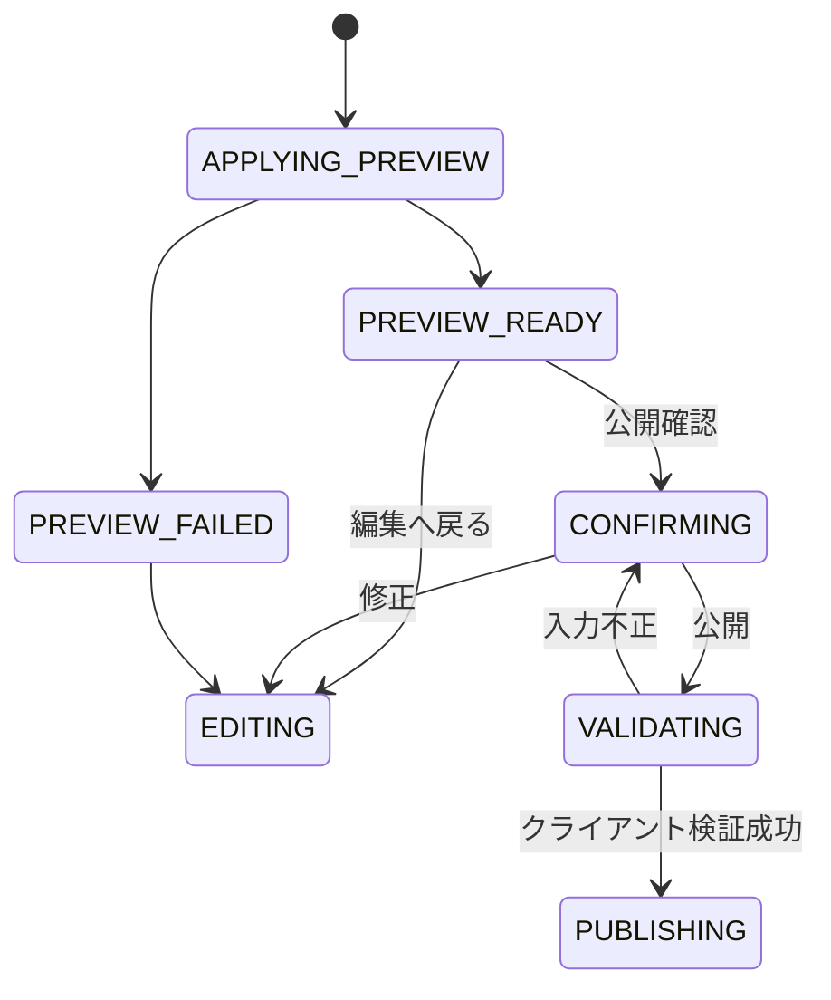

# F-06 3Dプレビュー・公開確認 詳細設計

作成日: 2026-08-22  
ステータス: 詳細設計決定版（実データ・性能検証前）

> 実装値は[設計決定記録](設計決定記録.md)を正とする。本文中の`UD-xxx`参照は未決を意味しない。

## 1. 目的

描画エディタが生成した未公開の統合PNGを本人の3D壁面だけへ一時反映し、向き、比率、境界、固定下地、描き足しを確認します。確認後にタイトル、表示名、上書き元の由来を提示し、F-07へ公開要求を引き渡します。

## 2. 対応要件

- FR-207、FR-210、FR-212、FR-214、FR-221
- NFR-002、NFR-008、NFR-017
- AC-005、AC-012、AC-022～024、AC-026

## 3. 入力

| 入力 | 内容 |
|---|---|
| 一時統合PNG | F-05が生成した未公開画像 |
| 画像属性 | 寸法、容量、画像ハッシュ |
| 編集コンテキスト | wallId、expectedWallRevision、全source情報 |
| プレビュー姿勢 | WallCanvasに事前登録されたカメラ情報 |
| 編集状態ハンドル | F-05へ戻るためのメモリ参照 |
| セッション | sessionId、表示名 |

## 4. 状態

F-07から公開失敗または競合が返った場合は、編集状態を保持したままF-05または競合確認へ移ります。

## 5. 3Dプレビュー

### 5.1 適用処理

1. 一時PNGの寸法、容量、デコード可否、マスク適合を再確認します。
2. 一時PNGからクライアント内だけで参照可能なテクスチャを作成します。
3. F-03の対象`wallId`へ、正式画像より優先する一時テクスチャとして設定します。
4. 対象壁面のプレビュー姿勢へカメラを設定します。
5. 「未公開プレビュー」であることを明示します。
6. 利用者が次を目視確認できる状態にします。
   - 上下左右と鏡像
   - 壁面の縦横比
   - マスク境界と位置
   - 描画開始時に固定した退色下地
   - 新しく描き足した内容

カメラ固定・操作可能範囲、サムネイル生成条件はUD-008です。

### 5.2 破棄

編集へ戻る、公開成功、キャンセル、別壁面へ移動する場合に、一時テクスチャとObject URL等を解放します。正式Artwork画像や編集レイヤーはこの操作で変更しません。

## 6. 公開確認画面

| 項目 | 内容 | 入力可否 |
|---|---|---|
| 対象壁面 | 壁面名、wallId | 不可 |
| 3Dプレビュー | 一時PNGを貼った壁面 | 不可 |
| 現在版 | revisionNo、expectedWallRevision | 不可 |
| 上書き元 | 現在Artwork、sourceAsOf、退色段階・進行度 | 不可 |
| 表示名 | 公開作品へスナップショット保存 | 可 |
| タイトル | 公開作品へ保存 | 可 |
| 公開可否 | 共有トークン状態、画像・入力検証 | 不可 |
| 操作 | 公開、編集へ戻る、キャンセル | 可 |

表示名・タイトルの必須性、最大長、許可文字はUD-017です。

## 7. クライアント公開前検証

公開ボタン押下時に次を検証します。

- 共有トークンが公開可能状態である。
- 編集コンテキストと一時PNGが同じwallIdに属する。
- 一時PNGが再生成後に編集内容と一致している。
- 可視編集レイヤーに描画内容がある。
- PNGがデコードでき、規定寸法、10MB以下である。
- マスク内が不透明、外側が透明である。
- expectedWallRevisionと全source情報が欠損していない。
- 壁面基底画像ハッシュ、PLATEAUデータ版、rendererVersionが欠損していない。
- 表示名・タイトルがUD-017の規則を満たす。

クライアント検証は操作補助であり、F-07のサーバー検証を省略しません。

## 8. F-07への引渡し

引渡しデータは次です。

- wallId
- sessionId
- 表示名、タイトル
- 一時統合PNG、寸法、容量、画像ハッシュ
- expectedWallRevision
- wallBaseImageHash、plateauDataVersion
- sourceWallRevisionId、sourceArtworkId、sourceAsOf
- sourceFadeStage、sourceFadeProgress、sourceRendererVersion
- sourceArtworkImageHash、sourceCanvasImageHash
- 新規idempotencyKey

画像はmultipart、expectedはrevision IDとNoの両方、idempotencyKeyは公開試行ごとのUUIDv4です。

## 9. 二重操作防止

- 公開要求送信後は公開ボタンを無効化します。
- 同じ公開試行の再送には同じidempotencyKeyを使います。
- 利用者が内容を修正した場合は別の公開試行として新しいキーを生成します。
- 公開中は送信を取消不可とし進捗を表示します。30秒timeout、同じ冪等キーで0.5/1/2秒の最大3回再試行です。

## 10. 応答別処理

| 応答 | 一時プレビュー | 編集内容 | 遷移 |
|---|---|---|---|
| 公開成功 | 正式URLへ差し替え後に解放 | 破棄 | F-03へ戻る |
| 入力不正 | 保持 | 保持 | 公開確認またはF-05 |
| 401 | 保持 | 保持 | 閲覧専用を表示 |
| 409競合 | 保持 | 保持 | F-07競合回復へ |
| 413 | 保持 | 保持 | F-05へ戻す |
| 500・503 | 保持 | 保持 | 同じキーで再試行可能 |
| 公開成功後の3D反映失敗 | 解放可 | 破棄 | 公開済みを明示し正式画像再読込 |

競合時の新旧固定下地比較画面と選択肢はUD-036です。

## 11. エラー・ログ

| 事象 | 処理 |
|---|---|
| 一時PNGデコード失敗 | F-05へ戻り再生成 |
| 3D適用失敗 | 編集保持、公開前確認を成立させない |
| プレビュー姿勢欠損 | 描画開始自体を設定不備として扱う |
| 公開入力不正 | 項目単位で表示、送信しない |

ログにはwallId、画像寸法・容量、プレビュー適用時間、検証結果、requestIdを記録し、画像本体・トークンを記録しません。

## 12. テスト観点

- 一時PNGが対象壁面だけに反映され、他利用者・履歴へ保存されない。
- プレビューと公開後で向き、比率、境界が一致する。
- 編集へ戻った後もレイヤーとUndo/Redoが残る。
- 編集内容なし、10MB超過、マスク不正を送信前に検出する。
- 公開処理中の二重クリックで複数要求を作らない。
- 失敗・競合で編集内容を保持する。
- 正式公開後の表示失敗を公開失敗と誤表示しない。

## 13. 関連する決定事項

UD-007、UD-008、UD-013～018、UD-024、UD-025、UD-032、UD-033、UD-035、UD-036、UD-038、UD-043、UD-050、UD-053は[設計決定記録](設計決定記録.md)で決定済みです。
