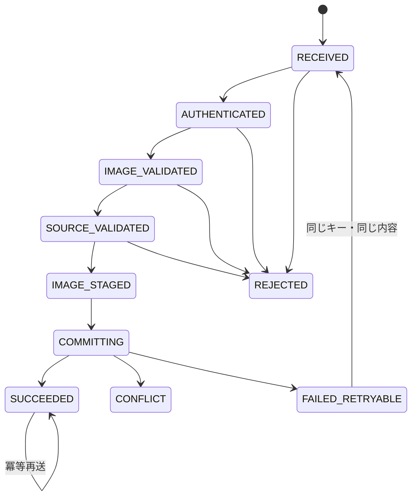

# F-07 作品公開・競合回復 詳細設計

作成日: 2026-08-22  
ステータス: 詳細設計ドラフト（未確定事項あり）

## 1. 目的

統合PNGと上書き元の由来を検証し、作品画像、Artwork、WallRevision、WallStateを分岐・重複なく確定します。画像保存とDB更新の部分障害、同時更新、応答喪失後の再送から安全に復帰します。

## 2. 対応要件

- FR-301～313、FR-701、FR-702、FR-704
- NFR-003、NFR-007、NFR-008、NFR-014、NFR-015、NFR-017
- AC-005、AC-012～015、AC-019、AC-024～030

## 3. 論理API

`POST /api/v1/walls/{wallId}/publications`

画像転送方式により単一要求または「画像候補アップロード＋確定要求」に分かれる可能性があります。どちらを採用するかはUD-014で決定し、本書では1つの論理公開操作として扱います。

## 4. 公開要求

| グループ | 項目 |
|---|---|
| 対象 | `wallId`、`expectedWallRevision` |
| 描画者 | `sessionId`、表示名、タイトル |
| 画像 | PNG本体または候補参照、width、height、容量、`imageHash` |
| 静的整合 | `wallBaseImageHash`、`plateauDataVersion` |
| 上書き元 | `sourceWallRevisionId`、`sourceArtworkId`、`sourceAsOf` |
| 退色由来 | `sourceFadeStage`、`sourceFadeProgress`、`sourceRendererVersion` |
| 画像由来 | `sourceArtworkImageHash`、`sourceCanvasImageHash` |
| 再送 | `idempotencyKey`、要求内容ハッシュに必要な値 |

`expectedWallRevision`をID、版番号または両方のどれにするかはUD-032です。

## 5. 公開処理状態

状態をArtworkだけで表すか、別の公開試行データを持つかはUD-038です。上図は必要な振る舞いを示す論理状態です。

## 6. 検証順序

### 6.1 認可・要求検証

1. requestIdを発行します。
2. 共有トークンを検証します。
3. レート制限を検証します。
4. wallId、必須項目、ID・時刻・列挙値の形式を検証します。
5. idempotencyKeyの既存状態と要求内容ハッシュを確認します。

共有トークン、レート値、冪等キーの形式・範囲・保持はUD-024、UD-025、UD-038です。

### 6.2 PNG検証

1. MIMEだけでなくPNGシグネチャとデコード成功を確認します。
2. width、heightがWallCanvasと一致することを確認します。
3. 容量10MB以下を確認します。
4. 実画素の画像ハッシュを再計算します。
5. 壁面マスクと同じ寸法であることを確認します。
6. マスク外が完全透明、マスク内が完全不透明であることを確認します。
7. 任意ファイル、実行可能内容、許可外画像を拒否します。

許可PNGチャンク、APNG、色タイプ、透明画素RGBの正規化はUD-043です。

### 6.3 静的・上書き元検証

1. Wallが存在し、描画可能・検証済みであることを確認します。
2. WallCanvasの`wallBaseImageHash`、`plateauDataVersion`と要求値を照合します。
3. WallState、現在WallRevision、現在Artworkを取得します。
4. expectedWallRevisionが現在版と一致することを確認します。
5. `sourceWallRevisionId`と`sourceArtworkId`が現在版の相互参照と一致することを確認します。
6. 上書き元が同じwallId、同じ基底ハッシュ、同じPLATEAUデータ版に属することを確認します。
7. `sourceArtworkImageHash`が保存済みArtwork画像と一致することを確認します。
8. `sourceAsOf`が上書き元表示開始以後、要求時点以前であることを確認します。
9. F-10で退色進行度、段階、固定下地画像を再現し、要求値と比較します。
10. `sourceCanvasImageHash`を再計算して照合します。

固定下地をサーバーで再生成する方式はUD-011～013、UD-033に依存します。

### 6.4 描画内容検証

クライアントは編集レイヤーが空なら公開を要求しません。サーバーでも固定下地と公開画像の差を必須にするか、その閾値をどうするかはUD-040です。決定前は、サーバー側の差分判定を勝手に追加しません。

## 7. 画像候補保存

1. 検証済みPNGを不変な候補キーへ保存します。
2. 同じidempotencyKey・同じ要求の再送で既存候補を再利用できるようにします。
3. DB確定前は正式公開済みとして外部表示しません。
4. DB成功後はArtworkから不変URLで参照します。
5. DBが確定しなかった候補は再送待ちまたは孤立候補として分類します。
6. 保持期限経過後も、DBから未参照であることを再確認してから削除します。

候補キー、正式URL、保持期限、削除ジョブはUD-039です。

## 8. DB公開トランザクション

論理トランザクションは次の順で実行します。

1. idempotencyKeyを再確認します。
2. WallStateとexpectedWallRevisionを再確認します。
3. 現在WallRevisionと現在Artwork、全source情報を再確認します。
4. 公開時のサーバーデモ時刻`publishedDemoAt`を取得します。
5. 旧現在Revisionの`displayEndAt = publishedDemoAt`を設定します。
6. USER Artworkを作成します。
7. `revisionNo = sourceRevision.revisionNo + 1`のWallRevisionを作成します。
8. 新Revisionの`displayStartAt = fadeStartAt = publishedDemoAt`とします。
9. WallStateを`wallId + expectedWallRevision`条件で新Revisionへ更新します。
10. 更新件数が1件でなければ競合として全DB変更をロールバックします。
11. idempotencyKeyへ成功結果を関連付けます。
12. トランザクションをcommitします。

新Revisionへ記録するrendererVersion、デモ時刻を過去へ戻した状態での公開、DB固有の分離レベル・制約はUD-016、UD-037、UD-041です。

## 9. 作成データ

### 9.1 Artwork

- `artworkType = USER`
- wallId、sessionId、表示名スナップショット、タイトル
- 不変画像URL、寸法、画像ハッシュ
- wallBaseImageHash、plateauDataVersion
- 全source項目
- 実時刻のcreatedAt
- 公開済みを表す状態または確定情報
- idempotencyKeyまたはその関連

### 9.2 WallRevision

- wallRevisionId、wallId
- 直前版番号＋1のrevisionNo
- 新Artworkへの参照
- デモ時刻のdisplayStartAt、fadeStartAt
- displayEndAt = null
- rendererVersion

### 9.3 WallState

- wallId
- 新currentRevisionId
- 新currentRevisionNo
- 更新実時刻

## 10. 冪等性

必要な振る舞いは次です。

| 条件 | 応答 |
|---|---|
| 未使用キー | 通常公開処理 |
| 同じキー・同じ内容・成功済み | 以前と同じ成功結果 |
| 同じキー・異なる内容 | 409、公開しない |
| 応答喪失後の同じ再送 | 重複Artwork・Revisionを作らない |
| 同じキーが処理中 | UD-038で待機・409・202等を決定 |
| 競合後の再公開 | 最新下地確認後、新しいキーを使う |

要求内容ハッシュへ含める項目、キーの一意範囲、保持期限はUD-038です。

## 11. 競合回復

1. 競合応答に最新currentRevisionId・revisionNoとrequestIdを含めます。
2. クライアントは固定下地以外の編集レイヤーとUndo/Redoを保持します。
3. F-04から最新編集コンテキストを取得します。
4. 旧下地と新下地の差し替えを利用者へ説明します。
5. 利用者が承認した場合だけ、固定下地とsource情報を新コンテキストへ置き換えます。
6. 保持していた編集レイヤーを新下地へ重ねます。
7. F-06で再プレビューします。
8. 新しいidempotencyKeyとexpectedWallRevisionで再公開します。

新旧比較方法、「差し替える」「編集へ戻る」「破棄」の具体操作はUD-036です。

## 12. 応答

### 12.1 成功

| 項目 | 内容 |
|---|---|
| `requestId` | 追跡ID |
| `artwork` | 公開済みArtwork |
| `wallRevision` | 新しい現在Revision |
| `wallState` | 新しい現在版情報 |
| `formalImageUrl` | 正式画像URL |
| `publishedDemoAt` | 公開に使ったデモ時刻 |
| `idempotentReplay` | 既存成功結果の再送か |

### 12.2 主な失敗

| HTTP | 論理コード | クライアント動作 |
|---:|---|---|
| 400 | `INVALID_REQUEST`、`INVALID_PNG` | 入力を修正 |
| 401 | `PUBLICATION_TOKEN_INVALID` | 閲覧専用表示 |
| 404 | `WALL_NOT_FOUND`、`SOURCE_NOT_FOUND` | 都市へ戻る・再取得 |
| 409 | `WALL_REVISION_CONFLICT` | 競合回復 |
| 409 | `IDEMPOTENCY_KEY_REUSED` | 内容を変えず再確認、新規試行なら新キー |
| 413 | `IMAGE_TOO_LARGE` | F-05へ戻る |
| 422 | `SOURCE_MISMATCH`、`WALL_NOT_DRAWABLE` | 描画を中止し再取得 |
| 500 | `PUBLICATION_FAILED` | 編集保持、同じキーで再試行 |
| 503 | `STORAGE_UNAVAILABLE` | 編集保持、バックオフ後に再試行 |

## 13. ログ・セキュリティ

| ログ | 項目 |
|---|---|
| 公開監査 | requestId、wallId、旧・新revisionNo、artworkId、結果 |
| 競合 | expected、actual、sourceRevisionId、発生実時刻 |
| 冪等 | キーのマスク済み識別、状態、再送判定 |
| 画像 | 候補識別、寸法、容量、ハッシュ検証、保存結果 |
| 退色再検証 | sourceAsOf、進行度、rendererVersion、結果 |

トークン、秘密鍵、画像本体をログへ出力しません。表示名以外の不要な個人情報を収集しません。

## 14. 性能

- 5MB以下は公開開始から壁面反映まで5秒以内を目標とします。
- 5MB超10MB以下は10秒以内を目標とします。
- 画像保存、DBトランザクション、正式テクスチャ適用を分けて計測します。
- タイムアウト、再試行、レート制限はUD-025です。

## 15. テスト観点

- 正常公開で旧版終了、新版追加、WallState更新が同時に成立する。
- revisionNoが欠番なく1増え、sourceRevisionが直前版を指す。
- 古いexpectedWallRevisionで既存状態を変更しない。
- 同時2要求から1件だけが成功し、履歴が分岐しない。
- 同じ冪等キーの再送で重複を作らない。
- 別壁、過去版、基底ハッシュ不一致、データ版不一致を拒否する。
- 画像保存後のDB失敗から同じ要求で復帰できる。
- 公開成功後の画像読込失敗で履歴を巻き戻さない。
- 競合後に最新下地を確認して編集を継続できる。
- 画像・DB・応答喪失の障害注入を行う。

## 16. 未確定事項

UD-003、UD-006、UD-011～017、UD-024～026、UD-032、UD-033、UD-035～043、UD-044、UD-052を参照してください。
