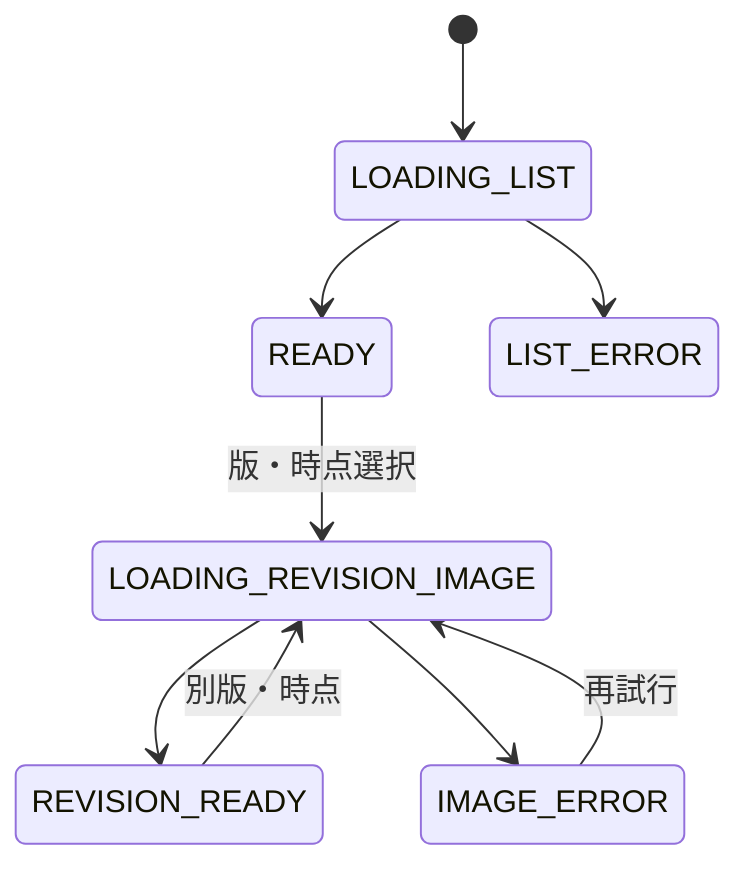

# F-08 履歴・タイムライン 詳細設計

作成日: 2026-08-22  
ステータス: 詳細設計決定版（結合検証前）

> 実装値は[設計決定記録](設計決定記録.md)を正とする。履歴は版選択と指定日時の両方を提供する。

## 1. 目的

壁面ごとに0番目から現在版までの分岐しない履歴を版番号順で表示し、各版の作品、作者、タイトル、表示期間、退色状態および直前の上書き元の由来を閲覧できるようにします。過去版から描画を開始する操作は提供しません。

## 2. 対応要件

- FR-401～408、FR-606
- NFR-007、NFR-008、NFR-017、NFR-018
- AC-007、AC-008、AC-015、AC-024、AC-026、AC-029

FR-405の区画全体の過去状態表示もMVPへ含めます。壁面履歴と同じ`at`解決規則をF-09で使用します。

## 3. 画面要素

| 要素 | 内容 |
|---|---|
| 壁面情報 | 壁面名、wallId、現在revisionNo |
| 版一覧 | 0番目から現在版までの連続番号 |
| タイムライン | 版番号または日時`YYYY-MM-DD HH:mm:ss JST`を選択するUI |
| 作品表示 | 選択版を選択時刻まで退色させた画像 |
| 作品情報 | 実作成時刻、表示名、タイトル、Artwork ID |
| 表示情報 | デモ表示開始・終了、退色開始、rendererVersion |
| 上書き元 | 直前Revision、Artwork、sourceAsOf、段階・進行度 |
| 操作 | 前版、次版、現在へ戻る、壁面詳細へ戻る |

実時刻・デモ時刻はラベルを分け、APIはUTC ISO 8601 ms、UIはJST秒表示とします。日時入力はscenario開始から現在デモ時刻までです。

## 4. 状態



## 5. 履歴取得

論理APIは`GET /api/v1/walls/{wallId}/revisions`です。

### 5.1 一覧応答

| 項目 | 内容 |
|---|---|
| `wallId` | 対象壁面 |
| `currentRevisionId`・`currentRevisionNo` | 現在版 |
| `revisions[]` | revisionNo昇順の一覧 |
| Revision | ID、番号、Artwork参照、表示開始・終了、退色開始、rendererVersion |
| Artwork要約 | ID、種別、画像URL・ハッシュ、作成実時刻、表示名、タイトル |
| source要約 | 直前版・作品、sourceAsOf、退色段階・進行度、各ハッシュ |
| 基底情報 | wallBaseImage URL・Hash、マスク、データ版 |

1壁面21リビジョン以下を基準とし、MVPではページングしません。

### 5.2 クライアント整合確認

- 一覧がrevisionNo 0から始まる。
- 番号が1ずつ増加し欠番・重複がない。
- 0番目がINITIALで、全source項目がnullである。
- USER版のsourceRevisionが直前版を指す。
- ArtworkとRevisionが一対一で対応する。
- 現在版だけdisplayEndAtがnullである。
- 隣接版の旧displayEndAtと新displayStartAtが矛盾しない。

不整合時は履歴を部分的に推測・補完せず、データ整合性エラーを表示します。

## 6. 版・時刻の選択

### 6.1 表示版

時刻`t`から版を選ぶ場合、次を満たすRevisionを1件だけ選びます。

```text
displayStartAt <= t
and (displayEndAt is null or t < displayEndAt)
```

版番号を直接選んだ場合は`displayStartAt`を既定時点にします。指定日時では半開区間に一致する版をserverの単一read transactionで1件だけ解決します。

### 6.2 退色表示

- revisionNo 0は時刻にかかわらず基底画像です。
- USER版は`GET /api/v1/renders/{wallRevisionId}?at={ISO}`でサーバー生成PNGを取得します。
- displayEndAt以後の時刻で旧版を現在表示として選びません。
- 旧版を「その表示期間内の状態」として閲覧し、現在のデモ時刻で再退色させません。

UIは秒表示ですが内部はms精度を保持し、終了時刻と同値なら次版を選びます。前版/次版/現在へ戻る操作を提供します。

## 7. 0番目表示

| 項目 | 表示 |
|---|---|
| 名称 | 元の壁面 |
| 作者 | なし／システム作品 |
| タイトル | ユーザー入力タイトルなし |
| 画像 | WallCanvasの壁面基底画像 |
| 退色 | 適用しない |
| 描画操作 | 表示しない |

現在版が0番目の場合も、描画は履歴画面からではなくF-04の壁面詳細へ戻って開始します。

## 8. 上書き元の由来表示

USER Artworkでは、少なくとも次を閲覧できるようにします。

- sourceWallRevisionIdと版番号
- sourceArtworkId
- sourceAsOf
- sourceFadeStage、sourceFadeProgress
- sourceRendererVersion
- sourceArtworkImageHash、sourceCanvasImageHash
- wallBaseImageHash、PLATEAUデータ版

ハッシュは全文を主画面へ常時表示する必要はありませんが、デモまたは技術確認で参照できる導線を持たせます。具体UIはUD-007です。

## 9. 閲覧専用制御

- 過去版に「描く」「この版を下地にする」「復元」「分岐」操作を置きません。
- 現在版を表示していても、履歴画面から固定コンテキストを引き継ぎません。
- 描画要求はF-04へ戻り、現在WallStateと新しいsourceAsOfを再取得します。
- URLやクライアント状態を改変して過去版を指定しても、F-07が現在版以外を拒否します。

## 10. 画像・性能

- 一覧メタデータと選択画像の読込を分離できます。
- 初期表示では全21画像を必ずデコードせず、選択版と近傍を優先できます。
- 不変画像はハッシュ付きURLでキャッシュします。
- 1壁面21版以下の一覧と現在版下地プレビューを2秒以内に表示することを目標とします。
- 退色画像のキャッシュキーはArtwork、基底、時点、rendererVersionを含めます。

## 11. エラー処理

| 事象 | 処理 |
|---|---|
| 履歴API失敗 | 壁面詳細を維持して再試行 |
| 欠番・分岐・参照不整合 | 履歴を推測表示せず整合性エラー |
| 選択Artwork画像失敗 | メタデータを残し、画像だけ再試行 |
| 退色生成失敗 | 元画像等へ勝手に代替せず、該当時点を表示不可にする |
| 現在版が更新された | 現在へ戻る操作時に一覧を再取得 |

## 12. ログ

| イベント | 項目 |
|---|---|
| 履歴取得 | wallId、件数、currentRevisionNo、所要時間、requestId |
| 整合性エラー | 欠番、重複、参照不一致、対象ID |
| 過去画像失敗 | artworkId、imageHash、rendererVersion |

履歴閲覧数を注目度として収集しません。

## 13. テスト観点

- 0番目から現在版まで昇順・欠番なしで表示できる。
- 20回上書き後の21版を2秒以内の目標で表示できる。
- 時刻境界で同時に2版を選ばない。
- 過去版の表示期間内退色を再現できる。
- 退色完了後も元Artworkとsource由来を閲覧できる。
- 過去版・現在版のどちらにも直接描画開始操作を置かない。
- 画像取得失敗時にメタデータと他版を閲覧できる。
- 分岐・欠番を検出し推測表示しない。

## 14. 関連する決定事項

UD-007、UD-012、UD-015、UD-019～021、UD-037、UD-046、UD-047、UD-049、UD-050は[設計決定記録](設計決定記録.md)で決定済みです。
