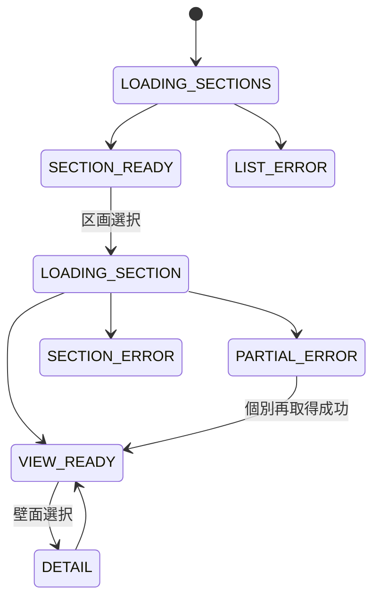

# F-09 区画一括ビュー 詳細設計

作成日: 2026-08-22  
ステータス: 詳細設計ドラフト（未確定事項あり）

## 1. 目的

選択した通路・区画に登録された全壁面と各現在作品を、設定された順序・左右方向・配置に従い同一画面へ同時表示します。3D都市ビューとは異なる鑑賞モードであり、壁面を1枚ずつ順送りする機能ではありません。

## 2. 対応要件

- FR-007、FR-107、FR-501～505
- NFR-006、NFR-008、NFR-017、NFR-020
- AC-009、AC-022

FR-405の区画全体の過去状態表示は推奨であり、MVPに含めるかUD-046で確認します。本書の確定範囲は各壁面の現在作品を同時表示する機能です。

## 3. 画面要素

| 要素 | 内容 |
|---|---|
| モード切替 | 3D都市ビューへ戻る |
| 区画選択 | WallSection一覧から選択 |
| 全体表示領域 | 全登録壁面を同時配置 |
| 全体fit | 全壁面を初期表示範囲へ戻す |
| 拡大・パン | 作品群の詳細鑑賞 |
| 壁面タイル | 壁面基底、現在作品、退色、壁面名、状態 |
| 個別詳細 | F-04壁面詳細を開く |
| エラー | 壁面単位の画像エラー、再試行 |

区画が1件だけの場合の選択UI、3D切替時の表示状態保持、一部失敗時の枠はUD-048です。

## 4. 状態

## 5. データ取得

### 5.1 区画一覧

論理API `GET /api/v1/sections`はsectionId、名称、説明を返します。静的設定だけでよい場合も、正式な配信方式はUD-015で確定します。

### 5.2 選択区画の現在状態

論理API `GET /api/v1/sections/{sectionId}/current`は次を一括返します。

| 項目 | 内容 |
|---|---|
| Section | sectionId、名称、説明、レイアウト版 |
| DemoClockSnapshot | 全壁面へ共通に適用する単一時点 |
| Items | 区画内の全WallSectionItem |
| Item配置 | order、左右方向、表示幅、正規化レイアウト |
| Wall | wallId、表示名、基底・マスク参照 |
| Current | WallState、現在Revision、現在Artwork |
| FadeInput | fadeStartAt、rendererVersion、画像・基底ハッシュ |

同一応答内の全壁面は同じデモ時刻スナップショットを使用します。

## 6. 整合確認

1. sectionIdが静的区画設定と一致することを確認します。
2. 登録Itemが1件以上あり、同じwallIdが重複しないことを確認します。
3. orderが区画内で一意であることを確認します。
4. 全ItemのWall、WallCanvas、現在版を解決します。
5. 左右方向、表示幅、レイアウト枠の必須値を確認します。
6. Artwork、基底画像、データ版を照合します。
7. 不整合Itemを推測配置せずエラーとして扱います。

## 7. レイアウト処理

### 7.1 配置

1. Itemをorder昇順に処理します。
2. 設定されたレイアウト枠へ壁面の縦横比を保持して配置します。
3. 左右方向設定に従い表示方向を決めます。作品を意図せず鏡像にしません。
4. 壁面名、状態ラベルは作品を隠しすぎない位置へ配置します。
5. 壁面画像はF-10出力を使用します。

正規化座標、余白、左右反転の実装、異なる画面比率での再配置はUD-022です。

### 7.2 初期fit

全Item枠の合成外接矩形を求め、画面の利用可能領域から規定余白を除いた範囲へ一括で収めます。次を満たします。

- 初期表示で全壁面が画面内に見える。
- 個別「前へ」「次へ」を必要としない。
- 拡大・パン後に全体fitへ戻れる。

余白率、最小表示サイズ、ラベル領域、レスポンシブ規則はUD-022、UD-031です。

## 8. 壁面画像

- 0番目は基底画像を表示します。
- USER現在版は共通デモ時刻でF-10を実行します。
- 3D都市ビューと同じArtwork、基底、マスク、rendererVersion、時刻を使用します。
- 祖先作品を再帰取得・合成しません。
- 画像失敗時は該当枠を保持し、壁面名、エラー、再試行を表示します。

一部失敗枠をfit計算へ含めるかはUD-048です。全壁面を一覧として認識できる要件から、失敗壁面自体を無言で除外しません。

## 9. 操作

| 操作 | 動作 |
|---|---|
| 区画選択 | 全所属壁面と現在版を一括取得し初期fit |
| 拡大 | ポインター位置または画面中心を基準に拡大。具体方式はUD-022 |
| パン | 作品群全体を移動 |
| 全体fit | 初期全体表示へ復帰 |
| 壁面選択 | F-04個別詳細を開く |
| 3D都市へ戻る | F-03へ切替 |

選択壁面、拡大率、パン位置をモード切替後も保持するかはUD-048です。

## 10. 退色・時計更新

- F-11の単一デモ時刻を全壁面に適用します。
- 画面内の12壁面を同じ更新契機でF-10へ渡します。
- 作品ごとのfadeStartAtが異なるため、同じ時刻でも段階が異なることは正常です。
- 停止中は全壁面の表示を固定します。
- 更新頻度、キャッシュ量子化、非表示タブからの再同期はUD-011、UD-012、UD-020です。

## 11. 性能

- 区画選択から12壁面・全現在作品の初期全体表示まで3秒以内を目標とします。
- 区画APIは全壁面を一括取得し、N+1 API呼出しを避けます。
- 画像は並列取得し、同一基底・作品の重複要求を避けます。
- 画面全体表示時は必要解像度に応じたGPU資源を使用できますが、正確な画像を変更・再圧縮しません。
- 基準端末と取得並列数はUD-002、UD-025です。

## 12. エラー・ログ

| 事象 | 処理 |
|---|---|
| 区画一覧失敗 | 3D都市へ戻れる全体エラー |
| 区画設定不整合 | 当該区画を表示せず設定エラー |
| 一部画像失敗 | 枠を維持して個別再試行 |
| 全画像失敗 | 配置枠とエラーを表示し一括再試行 |
| 退色生成失敗 | 該当枠を描画不可状態にし、別画像へ代替しない |

ログにはsectionId、壁面数、初期fit所要時間、全体表示所要時間、失敗wallId、requestIdを含めます。

## 13. テスト観点

- 選択区画の登録全壁面が同一画面へ同時表示される。
- 初期状態ですべて画面内に収まる。
- 順序、左右方向、縦横比、設定レイアウトが正しい。
- 3D都市と現在版・退色画像が一致する。
- 拡大、パン、個別詳細、全体fit、3D切替が機能する。
- 1画像失敗時も他の11壁面を表示できる。
- 12壁面を3秒以内の目標で表示できる。
- 個別の前後送りを必要としない。

## 14. 未確定事項

UD-002、UD-007、UD-011、UD-012、UD-015、UD-020～022、UD-031、UD-046、UD-048、UD-050を参照してください。
