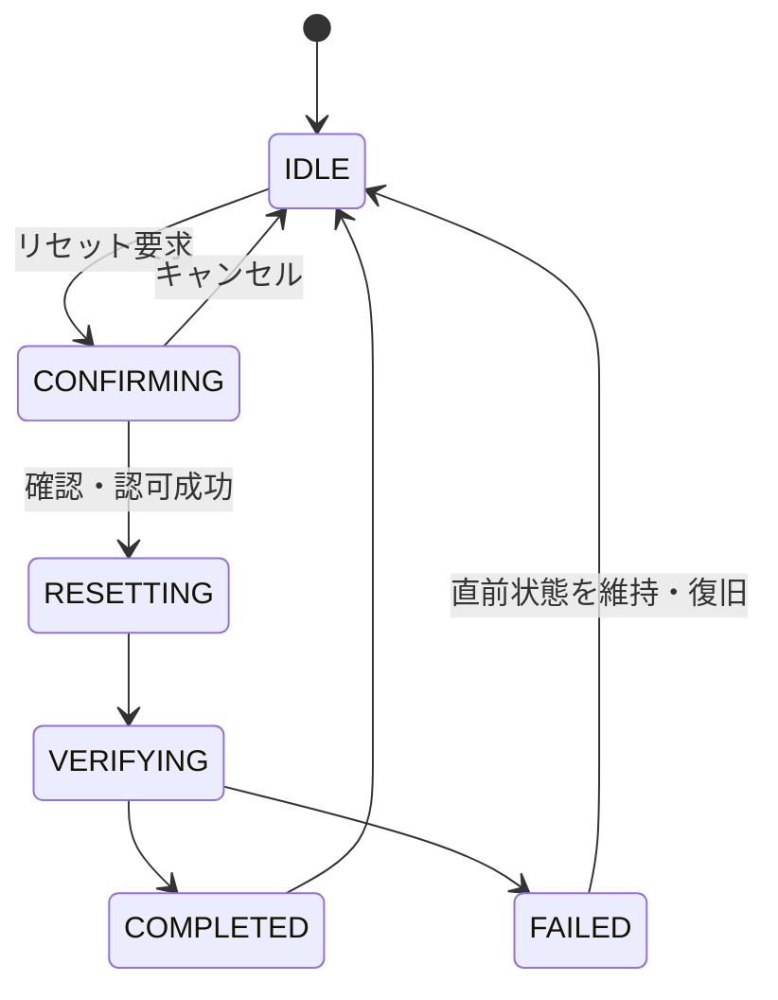

# F-11 デモ時計・状態リセット 詳細設計

作成日: 2026-08-22  
ステータス: 詳細設計決定版（結合検証前）

> 実装値は[設計決定記録](設計決定記録.md)を正とする。resetは新scenario生成とactive pointerの原子切替で行う。

## 1. 目的

実際の端末時刻と分離した仮想時刻を提供し、作品の15秒退色を再生、停止、先頭化します。また、発表用データを所定のシード状態へ1分以内に戻し、同じデモシナリオを再実行可能にします。

## 2. 対応要件

- FR-601～606、FR-802、FR-803
- NFR-009、NFR-017
- AC-010、AC-016、AC-027

## 3. 機能区分

| 操作 | 時計 | Artwork・Revision・WallState | 用途 |
|---|---|---|---|
| 取得 | 変更なし | 変更なし | 全画面の同期 |
| 再生 | 進行開始 | 変更なし | 退色デモ |
| 停止 | 表示時刻固定 | 変更なし | 状態説明 |
| 先頭化 | 所定の先頭時刻へ移動 | 変更なし | 退色だけ再演 |
| リセット | シード時刻へ復元 | 決定した方式で復元 | シナリオ全体の再実行 |

「先頭」の正確な意味、過去へ戻した時計での公開可否はUD-041です。

## 4. デモ時計モデル

DemoScenarioは論理的に次を持ちます。

| 項目 | 内容 |
|---|---|
| `scenarioId` | デモ状態の識別。採用範囲はUD-019 |
| `baseDemoTime` | 状態変更時点のデモ時刻 |
| `baseRecordedAt` | 状態変更時点のサーバー実UTC |
| `speed` | デモ時刻進行倍率 |
| `playbackState` | PLAYING、PAUSED |
| `rendererVersion` | 現在の新規表示に使う版 |
| `initializationSeed` | リセット元を識別する値 |
| 状態版 | キャッシュ無効化用。採用方法はUD-042 |

PLAYING時の論理算出は次です。

```text
demoNow = baseDemoTime + (serverRecordedNow - baseRecordedAt) * speed
```

PAUSED時は`demoNow = baseDemoTime`です。型、精度、speed値、クライアント補間はUD-020です。

## 5. 時計取得

論理API: `GET /api/v1/demo-scenarios/current`

応答には、時計モデル、応答生成時のサーバー実時刻、算出済みdemoNow、rendererVersion、状態版を含めます。F-01、F-03、F-08、F-09は同じスナップショットから現在時刻を算出します。

再同期周期、非表示タブ復帰、複数クライアントへの更新通知はUD-020です。

## 6. 時計コマンド

論理API: `POST /api/v1/demo-scenarios/current/commands`

### 6.1 共通処理

1. 共有トークンを検証します。
2. コマンド形式、対象状態版、二重操作を検証します。
3. 操作直前のdemoNowをサーバーで算出します。
4. コマンドに応じて基準時刻・実時刻・状態を更新します。
5. 状態版を更新します。
6. 前後状態を監査ログへ記録します。
7. 更新後の時計スナップショットを返します。

### 6.2 再生

- PAUSEDのbaseDemoTimeを維持し、baseRecordedAtを操作時実時刻へ更新してPLAYINGにします。
- 既に同じ状態の場合は状態版を増やさず200で現在状態を返します。

### 6.3 停止

- 操作時demoNowをbaseDemoTimeへ固定します。
- baseRecordedAtを操作時実時刻へ更新しPAUSEDにします。
- 全画面は更新応答後の同一時刻を表示します。

### 6.4 先頭化

- 時計だけを所定の先頭へ戻します。
- Artwork、WallRevision、WallState、作品画像を変更しません。
- 先頭時刻は全壁の現行Revision `displayStartAt`の最大値とし、停止状態へ戻します。

## 7. 15秒退色

- F-10の退色期間は15デモ秒です。
- speed 1で再生する場合、15実秒でp=0からp=1へ到達します。
- 各作品は固有のfadeStartAtを持つため、同じdemoNowでも進行度が異なり得ます。
- 発表で特定作品をp=0から再生するための先頭時刻・シード内容はUD-041、UD-042です。

## 8. リセット状態



確認UI、同期・非同期、排他ロック、処理中の公開応答はUD-027、UD-042です。

## 9. リセット論理処理

論理API: `POST /api/v1/demo-scenarios/current/reset`

1. 共有トークンとリセット権限を検証します。
2. 二重リセット、公開処理との競合を防止します。
3. initializationSeed、対象データ版、静的wallId集合を検証します。
4. 現在利用可能な状態を壊さない作業領域またはトランザクションで復元を開始します。
5. 新しいscenarioへseedを展開し、単一transactionで`ActiveScenario`を切り替えます。既存履歴は書き換えません。
6. 全描画壁面について、現在Revision、Artwork、WallState、画像参照を検証します。
7. 時計をシード状態へ復元し、rendererVersionと状態版を確定します。
8. 検証成功後だけ新状態を利用者から参照可能にします。
9. 動的キャッシュを無効化します。
10. 結果、状態版、所要時間を返します。

途中失敗時は、直前に利用可能だった状態を不整合な途中状態へ変えません。

## 10. リセットとエディタ・公開

リセット切替のSSEを受けた旧scenarioの編集コンテキストは即時`STALE_SCENARIO`へ遷移させ、公開を無効化して再取得を要求します。F-07も同じ理由で拒否します。

## 11. 認可・誤操作防止

- 時計変更とリセットは匿名閲覧から分離します。
- 共有トークンを必須にします。
- リセットは少なくとも確認操作を持ちます。
- 操作中の再実行を抑止します。
- 前後の時計状態、シード、結果を監査ログへ残します。
- トークン配布、確認文言、二段階操作、ロック方式はUD-024、UD-027、UD-042です。

## 12. エラー処理

| 事象 | 処理 |
|---|---|
| 時計取得失敗 | 最終取得値と同期異常を表示、再試行 |
| 時計変更競合 | 最新状態を返し再確認 |
| トークン不正 | 閲覧は維持し、変更だけ拒否 |
| シード不正 | リセットを開始しない |
| リセット途中失敗 | 直前状態を維持、復旧情報をログ |
| リセット時間超過 | 状態を確認できる応答を返し、実装方式に従い追跡 |

## 13. 性能・ログ

- リセットは1分以内を必須目標とします。
- 時計操作は全画面の再読込を必要としません。
- ログにはrequestId、操作、実行前後demoNow、speed、stateVersion、seed、所要時間、結果を記録します。
- 共有トークンはログに記録しません。

## 14. テスト観点

- 再生で15秒の4段階退色を見せられる。
- 停止中は全画面の表示時刻が変化しない。
- 先頭化で履歴データを変更しない。
- 3D、区画、履歴が同じ時計スナップショットを使う。
- 不正トークンでは閲覧を維持して変更だけ拒否する。
- リセットを1分以内に完了し、同じシナリオを再実行できる。
- 二重リセット、リセット中公開、途中障害で直線履歴を壊さない。
- 監査ログから操作前後を確認できる。

## 15. 関連する決定事項

UD-002、UD-006、UD-015、UD-019、UD-020、UD-024～027、UD-041、UD-042、UD-047およびISSUE-001、ISSUE-002は[設計決定記録](設計決定記録.md)で決定済みです。
