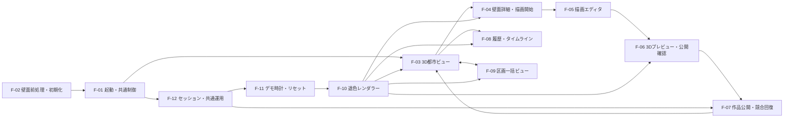

# OpenGraffiti 詳細設計書 索引

作成日: 2026-08-22  
最終更新日: 2026-08-31 
ステータス: 詳細設計決定版（実データ・性能検証前） 
対象: コンテスト提出用MVP  

参照資料:

- [PLATEAU建物別イラストテクスチャ生成方式（2026-10-29正式採用）](../PLATEAU建物テクスチャ生成/正式採用方式.md)
- [要件定義書](../../要件定義/要件定義書.md)
- [基本設計書](../基本設計/基本設計書.md)
- [開発アローダイアグラム](../../開発計画/アローダイアグラム.md)
- [課題一覧](../../課題管理/課題一覧.md)
- [設計決定記録](設計決定記録.md)
- [決定・検証状態一覧](未確定事項一覧.md)

> 本詳細設計は、要件定義書と基本設計書で確定している仕様を具体化します。`UD-001`～`UD-053`および`ISSUE-001`～`ISSUE-002`の結論は設計決定記録を正とします。

設計判断は全件決定済みです。ただし東京タワー周辺LOD3の壁面成立性、2D/3D往復、退色表現、描画性能、12壁レイアウトは実データ・実機検証前であり、検証合格前に完成とは扱いません。

## 1. 文書構成

| 機能ID | 詳細設計書 | 対応する基本設計コンポーネント | 主な責務 |
|---|---|---|---|
| F-01 | [アプリ起動・共通制御](F-01_アプリ起動・共通制御.md) | C-01 | 初期化、共通状態、画面遷移、共通エラー |
| F-02 | [壁面前処理・初期化](F-02_壁面前処理・初期化.md) | C-13 | CityGML抽出、2D・3D対応、静的成果物、0番目初期化 |
| F-03 | [3D都市ビュー](F-03_3D都市ビュー.md) | C-02 | GLB表示、壁面選択、現在作品、退色オーバーレイ |
| F-04 | [壁面詳細・描画開始](F-04_壁面詳細・描画開始.md) | C-03、C-05 | 壁面詳細、編集コンテキスト、上書き下地固定 |
| F-05 | [描画エディタ](F-05_描画エディタ.md) | C-06 | 固定下地、編集レイヤー、描画、Undo/Redo、統合PNG |
| F-06 | [3Dプレビュー・公開確認](F-06_3Dプレビュー・公開確認.md) | C-07 | 一時3D反映、公開内容確認、編集への復帰 |
| F-07 | [作品公開・競合回復](F-07_作品公開・競合回復.md) | C-08 | 公開検証、画像保存、直線履歴更新、冪等性、競合回復 |
| F-08 | [履歴・タイムライン](F-08_履歴・タイムライン.md) | C-09 | 0番目から現在版までの閲覧専用履歴 |
| F-09 | [区画一括ビュー](F-09_区画一括ビュー.md) | C-04 | 選択区画の全壁面・全現在作品の同時表示 |
| F-10 | [退色レンダラー](F-10_退色レンダラー.md) | C-10 | 退色進行度、4段階、共通画像生成、再現性 |
| F-11 | [デモ時計・状態リセット](F-11_デモ時計・状態リセット.md) | C-11、C-12 | 仮想時計、再生、停止、先頭化、シードリセット |
| F-12 | [セッション・公開制御・共通運用](F-12_セッション・公開制御・共通運用.md) | 横断機能 | デモセッション、共有トークン、ログ、キャッシュ、障害復旧 |

## 2. 機能依存関係

## 3. 共通設計規約

### 3.1 仕様の優先順位

1. 決定版の要件定義書
2. 基本設計書
3. 本詳細設計書群
4. コンセプト資料

下位資料が上位資料と矛盾する場合は上位資料を採用し、実装で吸収せず文書を修正します。

### 3.2 共通識別子

| 識別子 | 用途 | 不変性 |
|---|---|---|
| `areaId` | 対象エリア | データ版内で不変 |
| `buildingId` | アプリ内建物 | データ版内で不変 |
| `wallId` | 描画対象壁面 | MVP期間中不変 |
| `sectionId` | 通路・区画 | MVP期間中不変 |
| `artworkId` | 公開済み作品 | 発行後不変 |
| `wallRevisionId` | 壁面の版 | 発行後不変 |
| `revisionNo` | 壁面内の連続版番号 | 0から欠番なく増加 |
| `sessionId` | ブラウザ単位のデモ描画者 | 本人認証には使用しない |
| `scenarioId` | デモ状態の単位 | 全動的データの必須スコープ |
| `rendererVersion` | 退色アルゴリズムの版 | 公開済み履歴の再現に使用 |
| `requestId` | API・ログ追跡 | 要求ごとに一意 |
| `idempotencyKey` | 公開再送の重複防止 | 公開試行ごとに一意 |

### 3.3 時刻

- 実記録時刻はサーバーUTCで記録します。
- 表示期間、退色、`sourceAsOf`はデモ時刻を使います。
- API表現はISO 8601 UTCを基本とします。
- クライアント時計を整合性判定の正として使用しません。

### 3.4 画像

- 公開形式はPNGだけです。
- 長辺は2048px、短辺は壁面比率に従い512px以上、容量は10MB以下です。
- 壁面マスク内は不透明、マスク外は透明です。
- 壁面基底画像、マスク、固定下地、公開画像は同一寸法を使います。
- 画像ハッシュは寸法big-endianと正規化RGBA8を連結したSHA-256です。

### 3.5 API

- 本書のAPI名と`/api/v1`パスは論理インターフェースです。
- 読取は匿名、公開とデモ変更は共有トークン必須です。
- 正確なスキーマ、型、文字数、転送方式は[設計決定記録](設計決定記録.md)を参照します。
- クライアントから送信された版、時刻、ハッシュ、画像属性はサーバーで再検証します。

### 3.6 エラー処理

- 読取の一部失敗は、可能な範囲を表示したまま機能単位で再試行します。
- 描画開始条件を検証できない場合は描画を開始させません。
- 公開失敗時はタブを閉じるまで編集内容をクライアントメモリに保持します。
- 競合時は自動で公開せず、最新固定下地への差し替えを利用者へ確認します。
- 正式公開後の3D反映失敗では履歴を巻き戻さず、テクスチャだけ再読込します。

### 3.7 決定事項と検証事項の扱い

- `UD-xxx`の実装値は設計決定記録を正とし、各機能書の旧表記より優先します。
- `UD-028`～`UD-031`は方式決定済み・検証待ちであり、試験結果を記録してから合格扱いにします。
- PLATEAU実データが不合格の場合はLOD要件を暗黙に下げず、変更内容と工数差を文書化します。
- ISSUE-001、ISSUE-002は決定済みです。

## 4. 詳細設計書の共通完了条件

各機能は次を満たしたとき、詳細設計完了とします。

1. 入力、出力、前提条件、正常処理、例外処理が記載されている。
2. 使用する画面、API、データ、画像、ログが特定されている。
3. 要件・受け入れ条件との対応が記載されている。
4. 実装値が設計決定記録と一致している。
5. 検証待ちを合格済みと誤記していない。
6. 単体・結合・性能・障害時のテスト観点が定義されている。
