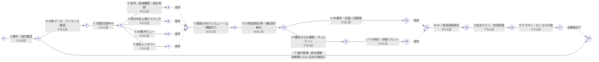
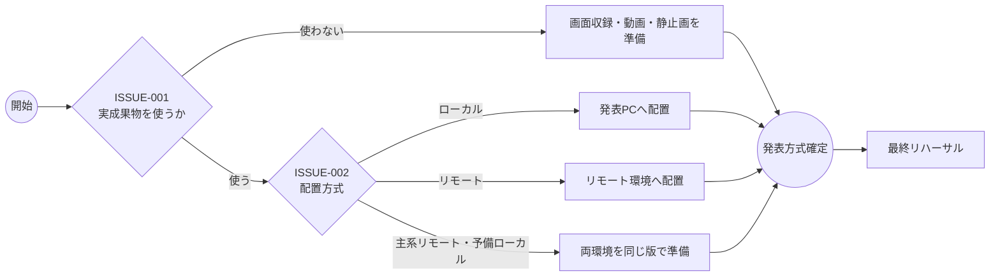

# OpenGraffiti 開発アローダイアグラム

作成日: 2026-07-26  
対象要件: [要件定義書](../要件定義/要件定義書.md)  
粒度: 機能単位  
工数前提: Codexを無制限に利用した場合の人の実作業工数  

## 1. 図の見方

- 丸数字は、複数の作業が開始・完了する節目を表します。
- 実線矢印は作業を表し、ラベル末尾の数値は最頻人日です。
- 点線矢印は工数を持たない依存関係です。
- 同じ節目から分岐する作業は並行実施できます。
- 合流する点では、流入するすべての作業が完了するまで次へ進めません。
- 工数はAIの実行時間を除いた人日です。1名体制では並行部分も順番に実施するため、図上の経過日数より長くなります。

## 2. 全体アローダイアグラム

Pは経過期間が2.5日という意味ではありません。A完了後から最終リハーサルまで続く管理作業へ、合計2.5人日を節目ごとに配分する「全期間作業」です。

## 3. 作業順序

### フェーズ1: 実装条件と技術成立性の確認

1. **A 要件・設計確認**
   - 決定済みの対象エリア、データ版、担当体制、技術構成を開発設定へ反映します。
   - API、データ形式、画面構成、0番目から始まる直線履歴を設計します。
2. **B 対象データ・ライセンス確認**
   - 対象PLATEAUデータ、LOD2 `WallSurface`、Appearance、元面ID、ライセンスを確認します。
3. **C 1壁面往復PoC**
   - 1壁面で、壁面抽出→基底画像生成→0番目の作品→上書き描画→3D再投影を検証します。
   - Cが不合格の場合、E以降へ進まず、壁面形状・変換方法・表示方式を見直します。

### フェーズ2: 1壁面の基盤機能を並行開発

C合格後に工数を再見積もりし、E～Hを1壁面対象で並行して実施できます。

- **E 保存・整合性制御**
  - `Artwork`、`WallRevision`、`WallState`、画像保存、現在版競合、冪等性を実装します。
- **F 描画エディタ**
  - 描画開始時の現在作品を、退色状態のまま固定下地にする上書きエディタを実装します。
- **G 3D都市ビュー**
  - 作品を実際の3D壁面へ貼り付けて閲覧するモードを実装します。
- **H 退色レンダラー**
  - 鮮明→色あせ→輪郭のみ→元の壁面、の共通画像生成処理を実装します。

### フェーズ3: 1壁面の縦切り完成後に12壁面へ展開

- **I 1壁面の3Dプレビュー・公開縦切り**
  - E～Hがすべて必要です。
  - 固定下地と描画を統合し、公開時に現在版を検証して次の版へ上書きします。
  - 1壁面で都市閲覧→描画→プレビュー→公開→3D再反映まで通してから、Dへ進みます。
- **D 壁面前処理・初期化**
  - 合格した1壁面の処理を12壁面へ展開し、UV、マスク、基底画像、0番目の作品、区画所属・表示レイアウトを生成します。
- **J 履歴・タイムライン**
  - D完了後、EとHの基盤を使います。
  - 0番目から現在版までの分岐しない履歴を、閲覧専用タイムラインとして表示します。
- **K 2つの鑑賞モード**
  - D完了後、E、G、Hの基盤を12壁面へ展開します。
  - 3D都市ビューと、選択区画の全壁面を同一画面へ同時表示する区画一括ビューを実装します。
- **L デモ時計・状態リセット**
  - J完了後に、退色の早回し、停止、初期化、同じシナリオの再現を実装します。

K、Lがともに完了した時点で、Mへ進みます。

### フェーズ4: 画面統合と品質確保

1. **M UI・発表導線統合**
   - 3D閲覧、区画一括閲覧、描画、公開、履歴、退色を一連の操作にまとめます。
2. **N 結合テスト・性能改善**
   - 要件定義書の受け入れ条件を実施し、ブラウザ、画像一致、競合、履歴、区画一括表示、性能を確認します。

### フェーズ5: 配置と発表準備

1. **O デプロイ・ローカル代替**
   - Nの合格と、必要な発表方式の決定後に開始します。
   - リモート配置可能な成果物とローカル起動手順を準備します。
   - 実際に発表で使用する方式は課題一覧のISSUE-001、ISSUE-002に従います。

### 全期間: 進行管理・統合調整

- **P 進行管理・統合調整**
  - A完了後から全期間にわたり、PoC判定、再見積もり、節目レビュー、意思決定、統合調整を行います。
  - O完了後に発表用データを初期化し、実際の発表手順を通す最終リハーサルまでを含みます。

## 4. 作業一覧と依存関係

| コード | 対応WBS | 機能単位の作業 | 先行作業 | 最頻人日 | 完了条件 |
|---|---|---|---|---:|---|
| A | W-01 | 要件・アーキテクチャ確認 | なし | 1.0 | API、データ形式、画面遷移、実装方針が確認済み |
| B | W-02 | 対象データ・ライセンス確認 | A | 2.5 | 対象データ、Appearance、出典、候補壁面が確認済み |
| C | W-03 | 1壁面往復PoC | B | 3.0 | 0番目→上書き→3D再投影が合格 |
| E | W-08 | 保存・直線履歴・競合制御 | C | 2.5 | 現在版更新、競合、冪等性、障害復旧が動作 |
| F | W-06 | 現在作品上書きエディタ | C | 4.0 | 退色状態の固定下地上へ描画可能 |
| G | W-05 | 3D都市ビュー | C | 4.0 | 現在作品を実際の3D壁面位置で閲覧可能 |
| H | W-11 | 退色レンダラー | C | 1.5 | 全画面で同じ退色画像を生成可能 |
| I | W-07 | 1壁面の3Dプレビュー・公開縦切り | E、F、G、H | 5.0 | プレビューと公開後が一致し、次版へ上書き可能 |
| D | W-04 | 12壁面前処理・初期化 | I | 6.0 | 全壁面の基底・0番目・区画設定が検証済み |
| J | W-09 | 履歴・タイムライン | D、E、H | 2.5 | 0番目から現在まで一本の履歴を閲覧可能 |
| K | W-10 | 3D都市・区画一括閲覧 | D、E、G、H | 2.5 | 2モードを切替でき、区画内全壁を同時表示可能 |
| L | W-12 | デモ時計・状態リセット | J | 1.0 | 15秒退色、停止、1分以内の初期化が可能 |
| M | W-13 | UI・発表導線統合 | K、L | 3.5 | 主要機能を一連の導線で操作可能 |
| N | W-14 | 結合テスト・性能改善 | M | 7.0 | MVP受け入れ条件と性能目標を満たす |
| O | W-15 | デプロイ・ローカル代替 | N、ISSUE-001（使用時はISSUE-002も） | 1.5 | 配置・起動・復旧手順を実行確認済み |
| P | W-16 | 進行管理・統合調整 | A後から全期間 | 2.5 | 節目レビュー、意思決定、統合、最終リハーサルが完了 |

## 5. 発表方式の決定フロー

[課題一覧](../課題管理/課題一覧.md)の未決事項は、Oを完了する前に次の順で決定します。

## 6. 暫定クリティカルパス

最頻工数と十分な並行要員を前提にした暫定クリティカルパスは次のとおりです。

`A → B → C → FまたはG → I → D → J → L → M → N → O`

FとGはいずれも4.0人日のため、同じ長さです。合計は約37人日です。

この37人日は、依存関係上短縮しにくい機能作業列の長さです。全期間に2.5人日を分散投入するPは単純加算していません。全作業の合計は50人日であり、1名体制では並行実施できないため、要件定義書どおり約10週間が最頻目安です。

## 7. 作業開始・停止の判断点

| 判断点 | 継続条件 | 不合格時 |
|---|---|---|
| C完了時 | 壁面基底、0番目、2D描画、3D再投影が正しい | E以降を止め、対象壁面または変換方式を見直す |
| I完了時 | 1壁面で現在版上書き、競合防止、プレビュー・公開一致が成立 | 12壁面へ展開せず、保存・描画・3Dの境界を修正する |
| K完了時 | 区画内全壁が同時表示され、3D都市と作品状態が一致 | 区画設定・画像読込・全体レイアウトを修正する |
| N完了時 | MVP受け入れ条件と発表端末の性能目標を満たす | デプロイせず、不具合修正またはMVP範囲を再判断する |
| O完了時 | 選択した発表方式で起動・復旧できる | 発表方式をローカルまたは収録資料へ切り替える |
